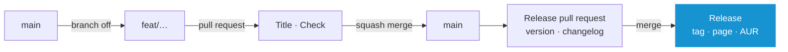

# Contributing

`main` is the only long-lived branch. Every change branches off it and comes back as one commit, and a release is one more pull request.

## Doing the Work

```
make check      # the whole gate, as CI runs it
make run        # the interface against a throwaway target/home
make build      # the release binary
make install    # ~/.local/bin/system-manager
```

```
sudo pacman -S --needed rust shellcheck yamllint actionlint zizmor gettext pacman-contrib
```

**Note:** _CI installs the same packages and runs the same commands in an Arch container. There is no second definition of green._

### Where a Change Belongs

- Reading or changing the system: `scripts/<area>/script.sh` and its `script.yaml`. Nothing in `src/` runs a command
- The interface: `src/ui/`, what it parses: `src/data/`
- German: `locales/de.po`. `make check` names every sentence missing or left over
- Themes: `themes/`, the AUR package: `aur/PKGBUILD`

**Note:** _How the pieces fit: **[➜ Reference](REFERENCE.md)**._

## Workflow



1. **Branch off `main`.** Name the branch after what it does: `feat/mirror-countries`, `fix/news-offline`. Nothing reads the name
2. **Open a pull request against `main` right away**, as a draft while it is not done. A branch is checked through its pull request, never on its own. Every push runs `Title` and `Check`, about four minutes
3. **Squash merge**, or switch on auto-merge. `main` takes the pull request once both have passed, as one commit under its title, and deletes the branch

## The Title

The title is the one line `main` keeps. The next version and the release notes are read from it, so it follows **[Conventional Commits](https://www.conventionalcommits.org)**: a type, a colon, what changed.

| Title | Version | On the Release Page |
| --- | --- | --- |
| `fix: keep the news while offline` | 2.0.0 → 2.0.1 | Bug Fixes |
| `feat: rank the mirrors of a chosen country` | 2.0.0 → 2.1.0 | Features |
| `feat!: settings move to ~/.config` | 2.0.0 → 3.0.0 | ⚠ BREAKING CHANGES |
| `docs:` `refactor:` `test:` `build:` `ci:` `chore:` | none | nothing |

- Write it for someone using the manager. `Title` refuses a title without a type and a pull request that does not target `main`, and checks again whenever the title is edited
- Merging shows the title and an empty description. Leave both as they are, with two exceptions typed into the description: `BREAKING CHANGE: …` tells the release page what somebody has to do, `Release-As: 3.0.0` sets a version that is chosen rather than counted

## What CI Runs

| Job | When | Does |
| --- | --- | --- |
| `Title` | A pull request is opened, pushed to or edited | Checks the title and the base branch |
| `Check` | Every pull request | `make check` |
| `Release` | A push to `main` | The release pull request, or once that is merged, the tag and the release page |
| `AUR` | A release | Stamps `aur/PKGBUILD` for the tag's source tarball, builds it with makepkg as a user would, which reads the version back from the binary, and pushes `PKGBUILD`, `.SRCINFO` and `arch-os-manager.install` to the AUR |

## Releasing

Nothing is typed and nothing is tagged by hand.

1. **Every merge that releases something** opens or updates the pull request `chore: release 2.1.0`. It raises the version in `.release-please-manifest.json` and writes that version's section of `CHANGELOG.md`
2. **Merging it is the release.** It starts no run of its own, so an admin merges it past the checks: `gh pr merge <number> --squash --admin`. The run on `main` tags `2.1.0`, publishes the page with the same notes, and `AUR` pushes the package

- Merges collect in the release pull request until it is merged. When to release is a decision, not a schedule
- Every build in between is named after a pre-release of the next patch, such as `2.0.1-dev`
- The key of `AUR` is the secret `AUR_SSH_KEY` of the environment `aur`, which only `main` may use. `tools/aur-key.sh` makes it and prints the public half for the AUR account
- Pictures are generated by hand and committed with the change: `docs/screenshots.sh 2.1.0`, then `docs/banner.sh`. They need `chromium`, `imagemagick`, `python` and `ttf-firacode-nerd`

## The Repository

What GitHub holds this repository to lives in **[.github/settings/](../.github/settings)**, not in clicks. An admin logged in with `gh` applies it:

```
make github
```

| File | Says |
| --- | --- |
| `repository.json` | Squash merges only, under the pull request's title alone; auto-merge allowed; a merged branch is deleted; no wiki, no projects |
| `ruleset.json` | `main` takes only a pull request that has passed `Check` and `Title`. An admin may merge one past them, which the release pull request needs. No force push, no deletion |
| `actions.json` | A workflow's token can only read unless it says otherwise, and may open the release pull request |

Run it again after changing one of them. The script is the same in every project released this way, and `ruleset.json` names each project's checks. No CodeQL: the only language it finds here is the workflows, which zizmor checks in `make check`.
