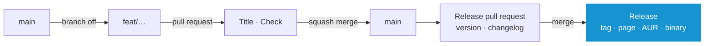

# Contributing

`main` is the only long-lived branch. Every change returns as one squashed commit, a release is one more pull request.

## Doing the Work

```
make check      # the whole gate, as CI runs it
make fmt        # cargo fmt and shfmt
make run        # interface against a throwaway target/home
make build      # release binary
make install    # ~/.local/bin/system-manager
```

```
sudo pacman -S --needed rust shellcheck shfmt yamllint actionlint zizmor gettext gitleaks pacman-contrib git stow age
```

**Note:** _CI runs the same commands in an Arch container._

### Where a Change Belongs

- Reading or changing the system: `scripts/<area>/<area>.sh` and its `<area>.yaml`. Nothing in `src/` runs a command
- Interface: `src/ui/`, parsers: `src/data/`
- German: `locales/de.po`, checked by `make check`
- Themes: `themes/`, AUR package: `aur/PKGBUILD`

**[➜ Reference](REFERENCE.md)**

## Workflow



1. **Branch off `main`**, named after the change: `feat/mirror-countries`, `fix/news-offline`
2. **Open a draft pull request against `main` right away.** Every push runs `Title` and `Check`, about four minutes
3. **Squash merge** or auto-merge once both pass. `main` keeps one commit under the title, the branch is deleted

## The Title

The title is the one line `main` keeps. Version and release notes are read from it, per **[Conventional Commits](https://www.conventionalcommits.org)**.

| Title | Version | On the Release Page |
| --- | --- | --- |
| `fix: keep the news while offline` | 2.0.0 → 2.0.1 | Bug Fixes |
| `feat: rank the mirrors of a chosen country` | 2.0.0 → 2.1.0 | Features |
| `feat!: settings move to ~/.config` | 2.0.0 → 3.0.0 | ⚠ BREAKING CHANGES |
| `docs:` `refactor:` `test:` `build:` `ci:` `chore:` | none | nothing |

- Written for users. `Title` refuses a title without a type and a base other than `main`, again on every edit
- The merge description stays empty, except `BREAKING CHANGE: …` for what users must do and `Release-As: 3.0.0` for a chosen version

## What CI Runs

| Job | When | Does |
| --- | --- | --- |
| `Title` | A pull request is opened, pushed to or edited | Checks title and base branch |
| `Check` | Every pull request | `make check` |
| `Release` | A push to `main` | Release pull request, after its merge the tag and release page |
| `Publish` | A release | Stamps `aur/PKGBUILD` for the tag, builds it with makepkg, pushes it to the AUR, attaches the binary to the release |

## Releasing

No manual tags.

1. **Every releasing merge** opens or updates `chore: release 2.1.0`. It raises `.release-please-manifest.json` and writes the section of `CHANGELOG.md`
2. **Merging it is the release:** tag `2.1.0`, release page with the same notes, `Publish` attaches `system-manager-2.1.0-x86_64`

- Merges collect in the release pull request until it is merged
- Builds in between carry a pre-release version, such as `2.0.1-dev`
- `RELEASE_TOKEN` of the environment `release`, `main` only: a fine-grained token with Contents and Pull requests read and write, stored by `.github/release-token.sh`. The workflow token cannot, as GitHub holds the checks of a bot's pull request. An expired token fails `Release`
- `AUR_SSH_KEY` of the environment `aur`, `main` only, made by `tools/aur.sh key`
- Pictures by hand with the change: `make screenshots VERSION=2.1.0`, then `make banner`. Needs `chromium`, `imagemagick`, `python`, `ttf-firacode-nerd`

## The Repository

**[.github/settings/](../.github/settings)** holds the GitHub configuration. An admin logged in with `gh` applies it:

```
make github
```

| File | Says |
| --- | --- |
| `repository.json` | Description and homepage. Squash merges only under the pull request title, auto-merge, merged branches deleted, no wiki, no projects. Secret scanning with push protection |
| `ruleset.json` | `main` takes only a squashed pull request that passed `Check` and `Title`. No force push, no deletion |
| `actions.json` | Workflow tokens read only unless stated otherwise |
| `topics.json` | Topics |

The script also enables Dependabot alerts and private vulnerability reporting. It is the same in every project released this way, `ruleset.json` names the checks. No CodeQL: clippy and zizmor cover Rust and the workflows in `make check`.

**Note:** _The social preview `docs/banner.png` is uploaded by hand under **Settings › General › Social preview**, as GitHub has no API for it._
