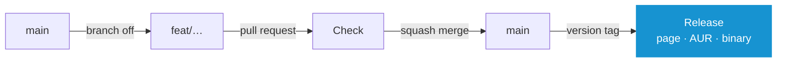

# Contributing

`main` is the only long-lived branch. Every change returns as one squashed commit, a release is one more pull request.

## Doing the Work

```
make check      # the whole gate, as CI runs it
make fmt        # cargo fmt and shfmt
make run        # interface against a throwaway target/home
make build      # release binary
make install    # ~/.local/bin/system-manager
```

```
sudo pacman -S --needed rust shellcheck shfmt yamllint actionlint zizmor gettext gitleaks pacman-contrib
```

**Note:** _CI runs the same commands in an Arch container._

### Where a Change Belongs

- Reading or changing the system: `scripts/<area>/<area>.sh` and its `<area>.yaml`. Nothing in `src/` runs a command
- Interface: `src/ui/`, parsers: `src/data/`
- German: `locales/de.po`, checked by `make check`
- Themes: `themes/`, AUR package: `aur/PKGBUILD`

**[➜ Reference](REFERENCE.md)**

## Workflow



1. **Branch off `main`**, named after the change: `feat/mirror-countries`, `fix/news-offline`
2. **Open a draft pull request against `main` right away.** Every push runs `Check`, about four minutes
3. **Squash merge** or auto-merge once it passes. `main` keeps one commit under the title, the branch is deleted

## The Title

The title is the one line `main` keeps. The release notes are read from it, per **[Conventional Commits](https://www.conventionalcommits.org)**.

| Title | Version | On the Release Page |
| --- | --- | --- |
| `fix: keep the news while offline` | 2.0.0 → 2.0.1 | Bug Fixes |
| `feat: rank the mirrors of a chosen country` | 2.0.0 → 2.1.0 | Features |
| `feat!: settings move to ~/.config` | 2.0.0 → 3.0.0 | ⚠ BREAKING CHANGES |
| `docs:` `refactor:` `test:` `build:` `ci:` `chore:` | none | nothing |

- Written for users. A title without a type lands under Other Changes
- The merge description stays empty

## What CI Runs

| Job | When | Does |
| --- | --- | --- |
| `Check` | Every pull request | `make check` |
| `Release` | A version tag | Checks the tag, writes the release notes |
| `Publish` | A release | Publishes the release page, stamps `aur/PKGBUILD` for the tag, builds it with makepkg, pushes it to the AUR, attaches the binary to the release |

## Releasing

A version tag on an up-to-date `main` releases, and `Publish` attaches `system-manager-2.3.0-x86_64`. The notes and their checks come from **[murkl/workflows](https://github.com/murkl/workflows)**, checked out next to this project:

```
../workflows/notes/notes.sh 2.3.0 && git tag 2.3.0 && git push origin 2.3.0
```

- Builds in between carry a pre-release of the patch after the last tag, such as `2.2.1-dev`
- `AUR_SSH_KEY` of the environment `aur`, version tags only, made by `tools/aur.sh key`
- A `Publish` that failed runs again with **Re-run failed jobs**. Tags never move, so a fix after a release is a new version
- Pictures by hand with the change: `make screenshots VERSION=2.1.0`, then `make banner`. Needs `chromium`, `imagemagick`, `python`, `ttf-firacode-nerd`

## The Repository

**[.github/settings/](../.github/settings)** holds the GitHub configuration. An admin logged in with `gh` applies it, with **[murkl/workflows](https://github.com/murkl/workflows)** checked out next to this project:

```
make github
```

| File | Says |
| --- | --- |
| `repository.json` | Description and homepage. Squash merges only under the pull request title, auto-merge, merged branches deleted, no wiki, no projects. Secret scanning with push protection |
| `ruleset-main.json` | `main` takes only a squashed pull request that passed `Check`. No force push, no deletion |
| `ruleset-tags.json` | No tag is moved or deleted |
| `actions.json` | Workflow tokens read only unless stated otherwise |
| `topics.json` | Topics |

The script also enables Dependabot alerts and private vulnerability reporting. `ruleset-main.json` names the checks. No CodeQL: clippy and zizmor cover Rust and the workflows in `make check`.

**Note:** _The social preview `docs/banner.png` is uploaded by hand under **Settings › General › Social preview**, as GitHub has no API for it._
