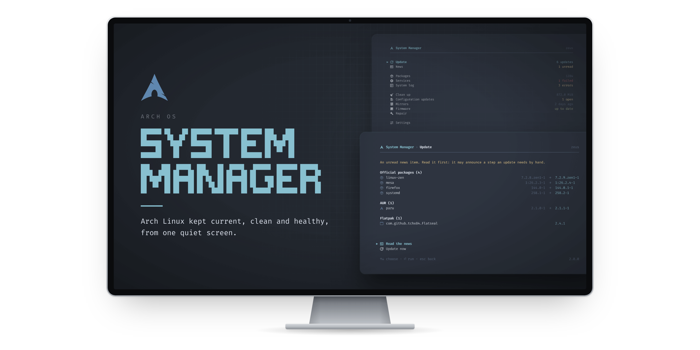
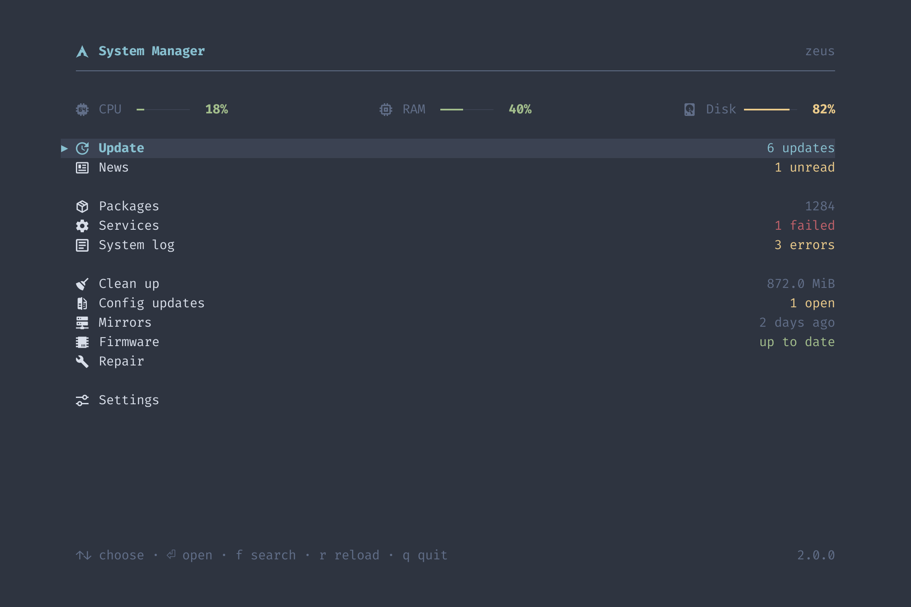
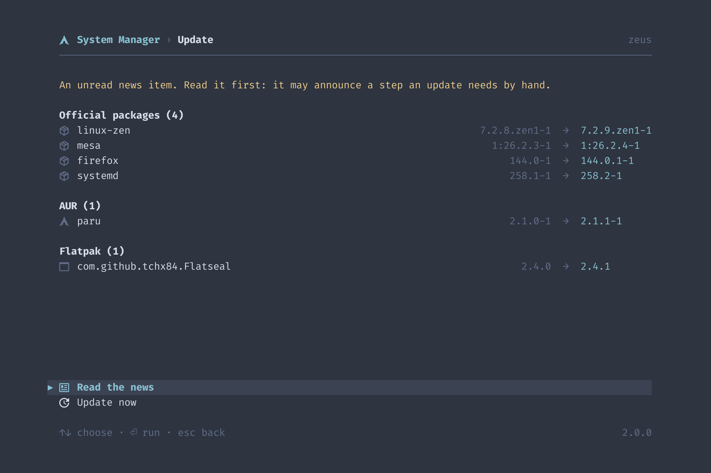

<div align="center">



<p>Simply <b>update</b>, <b>maintain</b> and <b>repair</b> Arch Linux from one place.</p>

**[➜ Reference](REFERENCE.md)** · **[➜ Contributing](CONTRIBUTING.md)**

<p>
  <a href="https://aur.archlinux.org/packages/arch-os-manager"></a>
  <a href="https://github.com/murkl/arch-os-manager/releases/latest"></a>
  <a href="../LICENSE"></a>
</p>

</div>

## Features

- Updates of the repositories, the AUR and Flatpak in one run, the Arch Linux news first
- Notification of new updates, or their count in the GNOME top bar
- Next steps after every run, a restart hint after a kernel update
- Common failures explained, with their fix
- Packages installed, removed or both in one run, the AUR included, older versions from the cache or the archive
- Services of the system and the user, started, stopped or enabled
- Errors of this boot, harmless ones hidden with one key
- CPU, memory and disk in use, live
- [Clean-up](REFERENCE.md#clean-up) of your choice, Docker and Podman included
- Config updates compared, merged or taken over
- Mirrors ranked, firmware updated
- A broken keyring renewed, damaged package files restored
- [Dotfiles](REFERENCE.md#dotfiles) per machine in your git repository, set up and backed up in one run, secrets encrypted
- Terminal, Linux console or a window of its own
- Runs in the terminal if you like, every command shown and every question yours
- English and German
- [Themes](REFERENCE.md#themes) such as Nord, Catppuccin, Tokyo Night and Gruvbox, or your own

[Optional packages](REFERENCE.md#optional-packages) add features, installed under **Settings › Optional packages**.

## Installation

From the **[AUR](https://aur.archlinux.org/packages/arch-os-manager)**, with paru or yay:

```sh
paru -S arch-os-manager
```

## First Start

```sh
system-manager
```

The first start adds the **System Manager** to the app menu. From there it runs in a window of its own.

<p align="center"><br><sub><b>Home</b> · the system at a glance, every task with its state</sub></p>

<p align="center"><br><sub><b>Update</b> · the news first, then every update with its versions</sub></p>
