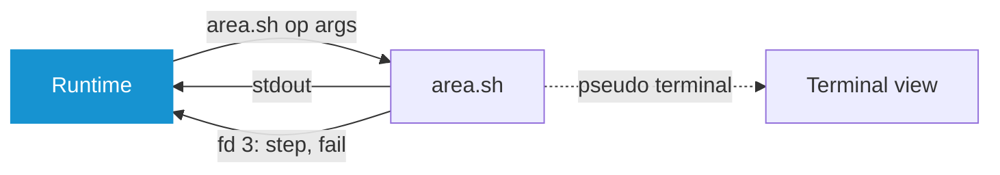

# Reference

## Command Line

| Command | Does |
|---|---|
| `system-manager` | Interface in the terminal, else in a window |
| `system-manager --window` | Interface in a window |
| `system-manager <page>` | Opens `upgrade`, `news`, `packages`, `services`, `log`, `cleanup`, `pacnew`, `mirrors`, `firmware`, `repair`, `dotfiles`, `homelab`, `settings` or `features` |
| `system-manager init` | Sets up the menu entry, the update notification and the update indicator |
| `system-manager check` | Prints pending updates like checkupdates, AUR as `aur/name`, an unknown version as `?`. Exit 2 without updates, 1 if a source failed and none had updates |
| `system-manager notify` | Announces pending updates, with `--new` only unannounced ones |

Runs as the user and asks for the sudo password itself. As root only `check` works. `check` and `notify` wait up to an hour for a running update.

## Keys

| Key | Outside a text box | In a text box |
|---|---|---|
| **↑↓**, **j k** | Choose | ↑↓ choose |
| **⇞⇟**, wheel | Scroll | the same |
| **⏎**, **l**, **→** | Open | ⏎ open, → cursor right |
| **esc** | Back | Close the box |
| **backspace**, **h**, **←** | Back | backspace delete left, ← cursor left |
| **f**, **/** | Filter, search on the start page | typed |
| **g**, **G**, **home**, **end** | First, last | g G typed, home end start and end of the text |
| **q** | Quit | typed |
| **ctrl+c** | Quit, in a run ask to stop | the same |
| **tab** | Run: compact view or terminal. Packages: mark | the same |
| **space** | News: read or unread | typed |
| **r** | Start page: read again | typed |
| **delete** | | Delete right |
| **ctrl+←→** | | Cursor a word left, right |
| **ctrl+backspace**, **ctrl+w** | | Delete the word left |
| **ctrl+u** | | Delete everything left |

The footer names the keys of each page. Held keys repeat only to move or type. Pasted text goes into a text box only.

## Start Page

The top row shows usage in percent, read every 2 s. `usage: false` hides it.

| Block | In use | Source |
|---|---|---|
| CPU | Busy ticks of the last 2 s | `/proc/stat` |
| RAM | Total minus `MemAvailable` | `/proc/meminfo` |
| Disk | `/` as `df` counts it | `statvfs` |

`success` below 75 %, `warning` below 90 %, else `error`. `?` marks a value not read.

## Runs

A run shows its step and pacman's progress. **tab** switches to the terminal, where every key goes to the program.


| Prompt | Compact view |
|---|---|
| `[Y/n]`, `[y/N]` | Yes or no, default first |
| `Enter a number (default=N):` | Numbered choices |
| `Enter a selection`, helper menus ending in `==>` | Text box, empty keeps the default |
| sudo prompt | Password |
| git's `Username for` | Text box |
| git's `Password for`, ssh and age passphrases | Hidden text box, held nowhere |
| ssh's question about an unknown host key | Yes or no, no first, with the fingerprint |

Other prompts wait in the terminal. pacman's `Proceed with installation?`, `Proceed with download?` and `Do you want to remove these packages?` are confirmed before the run. Conflicts, replacements and keys are always asked.

An update runs the repositories, the AUR, then Flatpak. A failed AUR helper does not stop Flatpak. Installs and removals run in one transaction, installs first. The update page names foreign packages the AUR does not know, as no update reaches them.

**esc**, **q** and **ctrl+c** ask to stop, yes sends ctrl+c. A run holds off shutdown and sleep, a closed terminal does not stop it.

| Offer after a run | When |
|---|---|
| Restart | A new kernel waits |
| Config updates | `.pacnew` or `.pacsave` files are open |
| Services | A service failed |
| Clean up | Marked unneeded packages or 1 GiB in marked parts, not after a clean-up |

Back after a success also closes the page the action came from.


### Verbose Output

`output: verbose` shows runs in the terminal only, tab does nothing. Every command is echoed as `$ sudo pacman -Syu`. No tool gets a yes flag, every prompt is typed. The password is still asked before the run.

### Password

Asked once per session before the first elevated run and checked with `sudo --validate`. Skipped with `NOPASSWD`. Never sent empty, as pam_faillock counts empty attempts. Kept in memory only and answers every sudo prompt of the session, AUR helper included.

### Repair

| Action | Does |
|---|---|
| **Repair the package management** | Removes a database lock no process holds, recreates the keyring, updates |
| **Check the package files** | `pacman -Qkk`, reinstalls native packages with missing or altered content, type or link. Owner, mode and time are ignored, hand-edited configuration stays, AUR packages are only listed |

Taking over or merging a config update first takes a snapper snapshot where snapper manages `/`. A merge is written beside the file and renamed over it. A sudoers file must pass `visudo`.

## Clean-Up

**⏎** marks a part, `settings.yaml` keeps the choice, **Remove now** removes after confirmation.

| Part | Removes | Default |
|---|---|---|
| `orphans` | Unneeded dependencies, `pacman -Rns` | marked |
| `cache` | Package files beyond 3 versions and of removed packages, `paccache -r`, `paccache -ruk0` | marked |
| `aur` | paru and yay build folders of removed packages | marked |
| `flatpak` | Unused runtimes, `flatpak uninstall --unused` | marked |
| `docker` | Unused images and the build cache, `image prune --all`, `builder prune --all` | unmarked |
| `podman` | Unused images, `image prune --all` | unmarked |

Containers and volumes stay. Reading never starts Docker: an inactive one starts for the clean-up alone and stops again. Its sizes need the group `docker`, the clean-up runs as root. Podman is per user. `? MiB` marks a size known only on removal.

## Dotfiles

**Settings › Dotfiles** switches them on, off by default. The start page then shows **Dotfiles** with what waits: new commits, a changed `init.sh`, missing links, or whether this machine is backed up.

The dotfiles are a git repository in `~/.dotfiles`: what every machine shares at the top, a folder per profile, and nothing else the manager needs. A profile is named after the host unless **Settings › Profile** chooses another, and a folder there is a profile when it holds one of its parts below. The manager makes a missing one once something goes into it, with `init.sh`, and the two files at the top where they are missing.

| In `~/.dotfiles/` | Content | Written by |
|---|---|---|
| `dotfiles.yaml` | The groups of the Dotfiles page, for every profile | you |
| `dotfiles.sh` | The function of each group, and helpers for `init.sh` | you |
| `home/` | Files of the home folder on every machine, `.foo` as `dot-foo` | **Add a file for every machine** |

| In `~/.dotfiles/<profile>/` | Content | Written by |
|---|---|---|
| `init.sh` | Your commands for this machine | you |
| `home/` | Files of the home folder on this machine, over those of every machine | **Add a file for this machine** |
| `secrets/` | Files of the home folder encrypted with age, each `<name>.age` | **Add a secret** |
| `key.age` | The age key of the secrets, behind your passphrase | the first secret |
| `packages/` | `pacman.txt`, `aur.txt`, `flatpak.txt`: the packages installed on purpose | **Back up** |
| `gnome/` | `extensions.txt` and the settings of each extension | **Back up** |
| `groups.txt` | The functions of the groups switched on | the Dotfiles page |

**Settings › Repository** takes the address GitHub or Gitea show for cloning. Without `~/.dotfiles` it clones, else it binds them to it, once the repository answers and shares their history. Empty, the dotfiles stay on this machine. Plain http and `git://` are refused, as they carry the dotfiles unencrypted. git and ssh ask for what they need in the run, and Arch OS keeps a token in the keyring and a key in its agent.

### Set Up and Back Up

**Set up** brings this machine to the state of its profile. What the profile brought since the last set up is applied, what this machine changed since stays for a back up:

| Step | Does |
|---|---|
| Latest state | The remote's commits, as a fast-forward or a rebase of the commits here, open changes stashed and back |
| Links | `stow --dotfiles --no-folding` from the profile's `home/`, then from the one of every machine, folders real. What stands where a link goes moves to `~/.dotfiles-backup/<time>/`, links to files gone from a `home/` go |
| Secrets | Each one missing here or changed in the profile, written for its owner only. The passphrase is asked once per machine |
| `init.sh` | Where it changed or never ran here |
| Packages | What the lists name and this machine lacks, from the repositories, the AUR and Flathub. One no repository has any more is named and left out |
| Groups | The function of each group switched on, where it changed or never ran here |
| GNOME | Missing extensions from extensions.gnome.org, settings and the list of extensions on where they changed |

**Back up** writes the package lists, the GNOME extensions and each secret changed here into the profile, commits every change of the dotfiles as `Back up <profile>: <parts>`, takes in the remote's commits and uploads. A branch without an upstream gets it at its first push.

What this machine applied lies in the clone and is never committed: `.git/system-manager/` holds the blob of each file as it was applied, the hash of each function of `dotfiles.sh` as it ran, the links of the last set up and the key once unlocked.

### Groups

`dotfiles.yaml` names the groups of every profile, in their order at the foot of the Dotfiles page:

```yaml
groups:
  - name: Gaming
    description: Steam, Lutris and Wine
    install: gaming
```

| Key | Meaning |
|---|---|
| `name` | The row on the Dotfiles page |
| `description` | One sentence under it, optional |
| `install` | The function of `dotfiles.sh` that sets the group up, its line in `groups.txt` |

`dotfiles.sh` holds functions as a PKGBUILD does, one per group and any helper. Set up reads it before every call, runs `init.sh` of the profile, then calls the function of each group switched on:

```bash
# dotfiles.sh
gaming() {
    sudo pacman -S --needed steam
}

# <profile>/init.sh
sudo pacman -S --needed zsh
```

**⏎** on a group switches it on and calls its function, or switches it off and leaves what it installed. Set up calls a function again where it changed, a comment or a space aside, and `init.sh` where the file changed. The functions run in `~/.dotfiles`, `init.sh` in the profile's folder with the functions at hand, all with `set -euo pipefail`, `SM_DOTFILES` and `SM_PROFILE` set, `LC_ALL=C.UTF-8`, and they may call `sudo`. Outside a function of `dotfiles.sh` stand only definitions. Ending with status 75 (`EX_TEMPFAIL`), a function or `init.sh` has not applied yet, for example while a program it configures was never started. Set up goes on and calls it again next time.

**Note:** _A function named like a program, such as `docker`, hides the program in `dotfiles.sh` and `init.sh`. A changed helper runs no function again that calls it._

### Files and Secrets

**Dotfiles › Files** adds a file or folder of the home folder and takes one out. Its browser goes a folder up with **←**. Added for every machine, it moves into `home/` at the top, for this machine into the profile's `home/`, and a link of stow takes its place. Where both hold a place, the profile's file is linked. Taken out, the file takes the place of its link again. A secret is encrypted into `secrets/` and its file stays where it is. **Change the passphrase** wraps the key anew, and a machine unlocked before keeps its key.

Without the manager, the files link the same way, the profile's first:

```sh
stow --dir ~/.dotfiles/<profile> --target ~ --dotfiles --no-folding home
stow --dir ~/.dotfiles --target ~ --dotfiles --no-folding --defer='.*' home
```

## Homelab

**Settings › Homelab** switches it on, off by default and only with the dotfiles. Without a homelab yet it asks for the name of a server, such as `nas.fritz.box`, and makes one in the dotfiles. Empty, it stays off.

```
~/.dotfiles/homelab/
├── homelab.yaml                 the servers and where their Cup answers
├── key.age                      the age key of its secrets, behind your passphrase
└── <server>/<stack>/compose.yaml
```

```yaml
servers:
  - name: nas.fritz.box
    cup: http://nas.fritz.box:8000
```

| Key | Meaning |
|---|---|
| `name` | The server as the network knows it, and its folder beside `homelab.yaml` |
| `cup` | The address of its Cup, http or https |

The manager makes the stack `cup` for the first server: [Cup](https://github.com/sergi0g/cup) behind a socket proxy that lets it read containers and images only. Rolled out on the server with `docker compose up -d` in its folder, it tells which images have updates. Until then **Homelab** names the server as not reached.

The start page counts the updates of every server. A server's page shows each stack as its needed images running, then an update, a newer tag, an image not running, or a check older than 48 hours. Images only a compose profile starts may be missing. **⏎** on a stack shows its images.

A secret of a server lies as `<file>.age` beside what it belongs to, under the key of the homelab, unlocked once per machine like a profile's. **Add a secret** encrypts a file of the home folder to a path in the server's folder and replaces one there. **Export** packs the server's folder with every secret decrypted as `<server>.tar` into the downloads folder, without anyone's names, readable by its owner only, and unpacks it once more to compare it with its source.

## Optional Packages

| Group | Package | Adds |
|---|---|---|
| `packages` | `paru` or `yay` | Builds and updates packages from the AUR |
| `packages` | `reflector` | Ranks the mirrors by speed |
| `packages` | `flatpak` | Updates and cleans up Flatpak apps |
| `packages` | `fwupd` | Updates the firmware of the device |
| `desktop` | `gnome-arch-update` | Shows pending updates in the top bar |
| `desktop` | `libnotify` | Shows desktop notifications about new updates |
| `desktop` | `meld` | Merges configuration updates side by side |
| `dotfiles` | `git` | Keeps the dotfiles in a repository |
| `dotfiles` | `stow` | Links the dotfiles into the home folder |
| `dotfiles` | `age` | Encrypts the secrets of the dotfiles |

A package counts when its `command` in `scripts/features/features.yaml` works. One that `needs` a fact is offered only where it holds:

| Fact | Holds when | Needed by |
|---|---|---|
| `desktop` | A session in `/usr/share/wayland-sessions` or `/usr/share/xsessions` | flatpak, meld, libnotify, the notification |
| `wayland` | A session in `/usr/share/wayland-sessions` | the menu entry |
| `gnome` | `gnome-shell` installed | gnome-arch-update |

**Settings › Optional packages** installs and removes each, removal with `pacman -Rns`:

| Package | Beyond pacman |
|---|---|
| `paru`, `yay` | Built with makepkg after `git` and `base-devel`, build dependencies removed. Removal takes the owner of the command, such as `paru-bin` |
| `reflector` | `/etc/xdg/reflector/reflector.conf`: https, synced within 12 h, 10 latest, by speed, country of the time zone. `reflector.timer` enabled, disabled on removal. **Refresh now** starts `reflector.service` |
| `fwupd` | `fwupd-refresh.timer` enabled, disabled on removal |
| `gnome-arch-update` | Arch Linux Updates Indicator from extensions.gnome.org, enabled for the user, active after the next login. Its commands run this binary. Removed with its settings |

## Settings

`~/.arch-os/settings.yaml`, an absent key is the default:

| Key | Values | Default |
|---|---|---|
| `language` | `en`, `de` | from `LC_ALL`, `LC_MESSAGES`, `LANG` |
| `theme` | a theme id | `nord` |
| `usage` | `true`, `false` | `true` |
| `status` | `true`, `false` | `true` |
| `aur-helper` | `paru`, `yay`, `none` | paru, else yay |
| `output` | `compact`, `verbose` | `compact` |
| `app-menu` | `true`, `false` | `true` |
| `notify` | `hourly`, `daily`, `weekly`, `off` | `hourly` |
| `flatpak` | `true`, `false` | `true` |
| `cleanup` | a part with `true` or `false` | `orphans`, `cache`, `aur`, `flatpak` |
| `hidden-log` | hidden system log messages | none |
| `dotfiles` | `true`, `false` | `false` |
| `dotfiles-profile` | a folder of `~/.dotfiles` | the host name |
| `homelab` | `true`, `false` | `false` |

- An unparsable file is ignored and named under **Settings › About**
- Every start and `init` set up the menu entry and the notification per `app-menu` and `notify`. An installer calls `init` from its chroot as the user
- The timer announces 2 minutes after login, then per `notify`. A notification stays until answered or replaced, and closes once nothing is pending
- `flatpak: false` leaves Flatpak to another app store. `all` is read as `true`, `cleanup` and `off` as `false`
- A hidden message ignores numbers, hex values and hashes
- The first start takes over the settings of the `arch-os` script before 2.0. `scripts/migrate/migrate.sh` says how to remove this

## Themes

```yaml
name: Nord
colors:
  background: "#2E3440"
  surface: "#3B4252"
  muted: "#616E88"
  text: "#D8DEE9"
  accent: "#88C0D0"
  success: "#A3BE8C"
  warning: "#EBCB8B"
  error: "#BF616A"
```

| Slot | Used for |
|---|---|
| `background` | Everything behind |
| `surface` | Bar and scrollbar tracks, the row under the cursor |
| `muted` | Hints, secondary values, disabled rows |
| `text` | Labels and text |
| `accent` | Cursor, title, progress, pending updates |
| `success`, `warning`, `error` | States |

The built-in themes in [`themes/`](../themes) meet WCAG AA: 4.5 for `text`, 3 for `accent` and the states. A file in `~/.arch-os/themes/` with a built-in id replaces it.

Icons are Nerd Font symbols, in a terminal from `ttf-nerd-fonts-symbols`. The Linux console (`TERM=linux`) gets 16 colours and ASCII.

## Files

| Path | Content |
|---|---|
| `~/.arch-os/settings.yaml` | Settings |
| `~/.arch-os/themes/<id>.yaml` | Own themes |
| `~/.arch-os/state.yaml` | News read, updates announced, the open notification |
| `~/.arch-os/state.lock` | Lock for `state.yaml` |
| `~/.arch-os/logs/system-manager.log` | Runtime and runs, rotated at 2 MiB |
| `~/.arch-os/cache/news.xml` | News feed for offline |
| `~/.local/share/applications/system-manager.desktop` | Menu entry |
| `~/.local/share/icons/hicolor/scalable/apps/system-manager.svg` | Icon |
| `~/.config/systemd/user/system-manager-notify.{service,timer}` | Update notification |
| `~/.local/share/gnome-shell/extensions/arch-update@RaphaelRochet/` | Update indicator |
| `~/.dotfiles/` | Dotfiles repository, with the dotfiles on |
| `~/.dotfiles-backup/<time>/` | What a set up replaced with a link or a secret |
| `<downloads>/<server>.tar` | Exported homelab server |

`SM_HOME` moves all of it, for a throwaway run.

## How It Works

```
src/                        runtime: interface, parsers, logging, no system command
scripts/<area>/<area>.sh    one system area, operations as functions op_<name>
scripts/<area>/<area>.yaml  what the runtime knows about them
scripts/lib/                lib.sh, sourced by every script, lib.yaml, causes every run may hit
themes/<id>.yaml            built-in themes
locales/de.po               German, English is in the code
assets/fonts/               Fira Code and icons for the window
aur/                        AUR package arch-os-manager
tools/                      AUR release, icon font, splash logo
```

One binary carries everything. Scripts are written per process to `$XDG_RUNTIME_DIR/system-manager-<pid>/`, readable by the user only, removed on exit. The interface thread does no file I/O. Log and state writes have own threads, the end waits up to 10 s for them.



## Scripts

`operation` in `lib.sh` runs `op_<operation>`, a dash in the name an underscore in the function.

| Way | Terminal | Prompts | Limit | Used for |
|---|---|---|---|---|
| Query | none | none | 120 s | Reading state, output the runtime parses |
| Run | own pseudo terminal | answered in the interface | none | Changing the system |

A query may not call `sudo`, the runtime refuses one with `root: true`. It runs at nice 10.

### The yaml

| Key | Meaning |
|---|---|
| `ops` | Each operation by name, with the keys below. build.rs makes it `script::op::<SCRIPT>_<NAME>` |
| `errors` | Exit code from 10: headline, then the next step if any. A test holds them against the `exit` lines |
| `hints` | Output line containing the key: `text` as for `errors`, `offer` the page that fixes it. `lib.yaml` holds pacman's |
| `probe` | `features` only: each optional package under its group, its `command`, what it `adds`, the fact it `needs`. `extension: true` comes from extensions.gnome.org |
| `facts` | `features` only: what a package may need of the system. `fact_<name>` in the script tests it |

| Operation key | Meaning |
|---|---|
| `title` | What it does, as a gerund: run title, start of its failure |
| `confirm` | Asked before the run: question, then the irreversible effect |
| `root` | Calls `sudo`, so the password is asked first. A test holds this against the function |
| `needs` | Optional packages it needs, unavailable until installed |
| `steps` | `step <key>` on fd 3 shows this text during the run |

Every text is English and translated in `locales/de.po`.

### Exit Codes

| Exit | Meaning |
|---|---|
| `0` | Done |
| `1` | Unexpected: the trap of lib.sh writes `fail\t<code>\t<file>\t<line>\t<command>` to fd 3 |
| `2` | No such operation |
| `10` to `99` | Declared in `errors` |

### Environment

| Variable | Value |
|---|---|
| `LC_ALL` | `C.UTF-8`, one known wording |
| `SM_AUR` | AUR helper, empty for none |
| `SM_FLATPAK` | `on` where Flatpak is installed and enabled, else `off` |
| `SM_RUN` | Run title, unset in a query |
| `SM_TERMINAL` | `on` with verbose output, else unset |
| `SUDO_PROMPT` | Fixed prompt the runtime recognises |
| `TERM` | `xterm-256color` in a run |

`lib.sh` sets `set -Eeuo pipefail`, `inherit_errexit` and `nullglob` and ignores a hangup. A run holds off shutdown and sleep through logind and its `run_lock`.

| Function | Does |
|---|---|
| `operation` | Runs `op_<name>`, last line of every script |
| `step` | Names the phase of a run |
| `allow` | Accepts the exit codes named, as `grep` ends with 1 on nothing |
| `scratch` | Own folder as `$work`, removed at the end |
| `fetch` | curl bound to https, redirects too, with time limits |
| `aur` | Helper of `$SM_AUR` |
| `aur_sync` | Helper without review and menus, with them in verbose output |
| `asks` | Whether tools prompt in verbose output, else each tool gets its yes flag |
| `run_lock` | Lock a run holds, for its queries to wait on |

A function more than one script needs goes into `lib.sh`.

### A New Operation

1. `op_<name>` in `scripts/<area>/<area>.sh`. A new area is a folder whose script sources `lib.sh` in its first two lines and ends with `operation "$@"`
2. Its entry under `ops` in `scripts/<area>/<area>.yaml`, at least `title`
3. Its texts in `locales/de.po`

`make check` fails until all three agree.

## Building

| Target | Does |
|---|---|
| `make check` | gitleaks, format, clippy, shellcheck, yamllint, actionlint, zizmor, msgfmt, tests, release build |
| `make fmt` | cargo fmt and shfmt |
| `make run` | Interface against a throwaway `target/home` |
| `make install` | `~/.local/bin/system-manager` |
| `make aur-check` | `aur/PKGBUILD` stamped with stand-ins, read by makepkg |
| `make screenshots VERSION=x.y.z` | `docs/screenshots/` from example data, showing that version |
| `make banner` | `docs/banner.png` from two screenshots, with chromium, imagemagick and Fira Code |
| `tools/aur.sh` | AUR package: stamp, build, push, binary on the release, key |
| `tools/icons.sh` | Icon font cut to what `src/ui/icon.rs` names |
| `tools/logo.sh` | Larger splash logo steps, rastered from the Arch Linux SVG |

Tests run on Arch, as in CI: scripts against stand-ins for pacman, sudo and others, read-only ones against the real pacman.

build.rs names a pre-release of the next patch, such as `1.9.2-dev`, unless `SM_VERSION` names the release.

**[➜ Contributing](CONTRIBUTING.md#workflow)**
