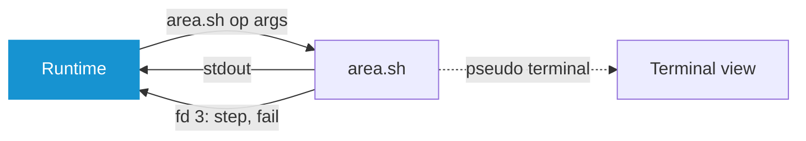

# Reference

## How It Works

```
src/                        the runtime: interface, parsers, logging, no system command of its own
scripts/<area>/<area>.sh    one area of the system, its operations as functions op_<name>
scripts/<area>/<area>.yaml  what the runtime knows about them, beside the files it puts in place
scripts/lib/                lib.sh, sourced first by every script, and lib.yaml, the causes every run may hit
themes/<id>.yaml            built-in themes
locales/de.po               German, the English source is in the code
assets/fonts/               Fira Code and the icons, for the window
aur/                        the AUR package arch-os-manager, stamped at a release
tools/                      the AUR release and the icon font, by hand or in CI
```

One binary carries all of it. The scripts are written to `$XDG_RUNTIME_DIR/system-manager-<pid>/` per process, readable by the user only, and removed on exit.

After the start, the thread of the interface reads and writes no file. The log and the writes of `settings.yaml` and `state.yaml` each have a thread of their own, and the end waits up to 10 s for what is still on its way. At most 1024 messages wait for the interface, so a run that prints faster waits at its terminal.



## Scripts

`operation` in `lib.sh` runs `op_<operation>`, a dash in the name an underscore in the function. An operation reads in one of two ways:

| Way | Terminal | Questions | Limit | Used for |
|---|---|---|---|---|
| Query | none | none | 120 s | reading state, printing lines the runtime parses |
| Run | its own pseudo terminal | answered in the interface | none | changing the system |

A query may not call `sudo`, and the runtime refuses to start one whose yaml says `root: true`. It runs at nice 10, behind the interface and the runs.

### The yaml

| Key | Meaning |
|---|---|
| `ops` | Each operation by name, with the keys below. build.rs makes it `script::op::<SCRIPT>_<NAME>` |
| `errors` | Exit code from 10 on: headline, then explanation. A test holds them against the `exit` lines |
| `hints` | Output line containing the key: `text` as headline, then explanation, `offer` the page that fixes it. `lib.yaml` holds pacman's |
| `probe` | `features` only: each optional package under its group, the `command` that proves it works, what it `adds`, and the fact it `needs`. One with `extension: true` comes from extensions.gnome.org |
| `facts` | `features` only: what a package may need of the system, with why it is not offered without. `fact_<name>` in the script tells whether it holds |

| Operation key | Meaning |
|---|---|
| `title` | What it does, as a gerund: the title of its run, the start of its failure |
| `confirm` | Asked before the run: the question, then what happens |
| `root` | It calls `sudo`, so the password is asked before the run. A test holds this against the function |
| `needs` | Optional packages it cannot run without, shown as unavailable until they are there |
| `steps` | `step <key>` on fd 3 shows this sentence during the run |

Every sentence is English and translated in `locales/de.po`.

### Exit Codes and Events

| Exit | Meaning |
|---|---|
| `0` | Done |
| `1` | Unexpected: lib.sh's trap wrote `fail\t<code>\t<file>\t<line>\t<command>` to fd 3, and the runtime shows that line |
| `2` | No such operation |
| `10` to `99` | Declared in `errors` |

### Environment

| Variable | Value |
|---|---|
| `LC_ALL` | `C.UTF-8`: output and questions in one known wording |
| `SM_AUR` | The AUR helper of the settings, empty for none |
| `SM_FLATPAK` | `on` where Flatpak is installed and its updates are on, else `off` |
| `SM_RUN` | The title of a run, unset in a query |
| `SM_TERMINAL` | `on` in a run shown in the terminal, else unset |
| `SUDO_PROMPT` | A fixed prompt the runtime recognises |
| `TERM` | `xterm-256color` in a run |

`lib.sh` sets `set -Eeuo pipefail`, `inherit_errexit` and `nullglob`, and ignores a hangup, so a closed terminal stops no run. A run holds shutdown and sleep off through logind and its `run_lock` while it lasts. It offers:

| Function | Does |
|---|---|
| `operation` | Runs `op_<name>`, as the last line of every script |
| `step` | Names the phase of a run |
| `allow` | Lets a command end with the codes named, as `grep` ends with 1 on nothing |
| `scratch` | A folder of the operation's own as `$work`, removed when it ends |
| `fetch` | curl bound to https, redirects too, with time limits |
| `aur` | The helper of `$SM_AUR` |
| `aur_sync` | The helper without the review and menus a run cannot answer, in the terminal with them |
| `asks` | Whether the tools ask, the person answering in the terminal. Else the script gives each tool its flag |
| `run_lock` | The lock in the runtime folder that a run of the script holds, for its queries to wait on |

A function more than one script needs goes into `lib.sh`.

### A New Operation

1. `op_<name>` in `scripts/<area>/<area>.sh`. A new area is a folder whose script starts with the two lines that source `lib.sh` and ends with `operation "$@"`
2. Its entry under `ops` in `scripts/<area>/<area>.yaml`, with at least `title`
3. Its sentences in `locales/de.po`

`make check` fails until all three agree.

## The Start Page

Under the header, one row shows in percent what the machine uses, read every two seconds. `usage: false` switches it off:

| Block | In use | Read from |
|---|---|---|
| CPU | Busy ticks of all, over the last two seconds | `/proc/stat` |
| RAM | What `MemAvailable` leaves, as `free` counts it | `/proc/meminfo` |
| Disk | Of `/`, as `df` counts it | `statvfs` |

A share reads in `success` below 75 %, `warning` below 90 % and `error` from there. Short of room the bars go first, then the names where icons say them. The spinner turns in a value still being read, on every row of the start page and in Settings alike, and `?` stands where a value could not be read. Where the menu would not fit under the row, and during a search, the row does not show.

## Runs

A run is named in the header after the action chosen, and shows its step and pacman's progress. **tab** switches to the terminal itself, where every key goes to the program. A question appears in both: in the overview as a choice, in the terminal as typed. The terminal ends with the outcome as the overview names it.


| Question | Overview |
|---|---|
| `[Y/n]`, `[y/N]` | Yes or no, the default first |
| `Enter a number (default=N):` | The numbered choices, such as providers |
| `Enter a selection` and helper menus ending in `==>` | A text box, where enter keeps the default |
| The sudo prompt | The password |
| git's `Username for` | A text box |
| git's `Password for`, the passphrase of ssh and age | A hidden text box, its answer held nowhere |
| ssh's question about a host it has no key of | Yes or no, no first, with the fingerprint |

pacman's `Proceed with installation?`, `Proceed with download?` and `Do you want to remove these packages?` are answered yes: the person confirmed before the run. Conflicts, replacements and keys are always asked.

A run holds shutdown and sleep off while it lasts, and a closed terminal does not stop it.

An update takes the repositories, then the AUR, then Flatpak where `flatpak` is on. A failing AUR helper leaves Flatpak still to update and is then named. The list of updates names a source it could not ask, as the AUR during an outage, and shows what the others have.

Packages marked to install and to remove go in one run. The installs come first, so a replacement takes the old package out in the same transaction or provides what depends on it.

**esc**, **q** and **ctrl+c** ask whether to stop, and yes sends ctrl+c to the program. A failure shows the declared error or a recognised cause, the source line, the last output and the log, and offers the page the cause names, another try and the way back.

After a run, the manager reads the system again and offers what may follow, none of it a must:

| Offer | When |
|---|---|
| Restart | A new kernel waits |
| Config updates | `.pacnew` or `.pacsave` files are open |
| Services | A service failed |
| Clean up | Marked unneeded packages, or 1 GiB to free in the marked parts, and not after a clean-up |

Back after a success also closes the page the action was chosen on, so a package leads back to the search and the update to the main menu. An offer opens in its place. After a failure, back leads to that page.


**Note:** _A question in another shape still waits in the terminal view, which tab reaches._

### The Terminal

`runs: terminal` shows a run in the terminal only, and tab does nothing. Every program is echoed as `$ sudo pacman -Syu` before it runs, a pipe as its parts and without its redirections, as bash traces it. No tool is told yes: pacman asks before each transaction, paru shows its review and yay its menus, Flatpak, fwupd, Docker and Podman ask as well, and the answers are typed. The password is still asked once before the run. The outcome lies on a card over the last output.

### The Password

Asked once per session, before the first run that elevates, and proven with `sudo --validate`. `sudo --non-interactive --validate` tells beforehand whether it is needed at all, so with `NOPASSWD` it is never asked. sudo never gets an empty password: pam_faillock counts an unanswered prompt and an empty password as failed attempts, and locks the account after three. It is held in memory only, answers every later sudo prompt of every run, also those of an AUR helper, and is written only while the terminal does not echo. A wrong one is forgotten and asked again.

### Repair and Configuration

**Repair the package management** removes a database lock no process holds, builds the keyring anew beside the old one and updates. **Check the package files** runs `pacman -Qkk` as root and installs every native package again whose file lost its content, type or link, or is missing. Owner, mode and time do not count, as a filesystem such as the vfat of `/boot` keeps them its own way. A configuration changed by hand is a backup file pacman lists apart, and a package of the AUR is only named. Taking over or merging a configuration update first takes a snapshot where snapper keeps the root. A merge is written beside the configuration and renamed over it, and a sudoers file must pass `visudo` first.

## Files

| Path | Content |
|---|---|
| `~/.arch-os/settings.yaml` | What was chosen, an absent key being the default |
| `~/.arch-os/themes/<id>.yaml` | Own themes |
| `~/.arch-os/state.yaml` | News read, updates already announced, the notification still standing |
| `~/.arch-os/state.lock` | Held while the interface or the timer changes `state.yaml` |
| `~/.arch-os/logs/system-manager.log` | The runtime and every run, rotated at 2 MiB |
| `~/.arch-os/cache/news.xml` | The feed as last loaded, for offline |
| `~/.local/share/applications/system-manager.desktop` | The app menu entry, opening the window |
| `~/.local/share/icons/hicolor/scalable/apps/system-manager.svg` | Its icon, the Arch OS logo |
| `~/.config/systemd/user/system-manager-notify.{service,timer}` | The update notification, as often as `notify` says |
| `~/.local/share/gnome-shell/extensions/arch-update@RaphaelRochet/` | The update indicator, when installed |
| `~/.dotfiles/` | The dotfiles, with the dotfiles switched on **[➜ Dotfiles](#dotfiles)** |
| `~/.dotfiles-backup/<time>/` | What stood where a set up put a link or a secret |
| `<downloads>/<server>.tar` | A server of the homelab, exported |

`SM_HOME` puts all of it elsewhere, for a throwaway run.

## Settings

| Key | Values | Default |
|---|---|---|
| `language` | `en`, `de` | from `LC_ALL`, `LC_MESSAGES`, `LANG` |
| `theme` | a theme id | `nord` |
| `usage` | `true`, `false` | `true` |
| `aur-helper` | `paru`, `yay`, `none` | paru, else yay |
| `runs` | `overview`, `terminal` | `overview` |
| `app-menu` | `true`, `false` | `true` |
| `notify` | `hourly`, `daily`, `weekly`, `off` | `hourly` |
| `flatpak` | `true`, `false` | `true` |
| `cleanup` | a part with `true` or `false` | `orphans`, `cache`, `aur`, `flatpak` |
| `hidden-log` | messages hidden from the system log | none |
| `dotfiles` | `true`, `false` | `false` |
| `dotfiles-profile` | a folder of `~/.dotfiles` | the host's name |
| `homelab` | `true`, `false` | `false` |

A file that does not parse is left alone and named under **Settings › About**, and the defaults apply until a setting is changed. A setting that cannot be written says so under the settings until a write succeeds. The first start or `init` takes the settings of the `arch-os` script before 2.0 over once, where none are chosen, and removes what it left. `scripts/migrate/migrate.sh` says how to remove this.

Every start and `system-manager init` put the app menu entry and the update notification in place as `app-menu` and `notify` say, for the binary where it lies now, and point the update indicator at it where installed. An installer calls `init` from its chroot as the user, through a private bus of `dbus-run-session` where none answers. The entry needs a Wayland session, as the window does, the notification a desktop and libnotify, and its button a Wayland display. The timer announces two minutes after login and then as often as chosen.

A notification stands until it is answered, and its button works until the timer comes back. Unanswered, it closes and the next one shows what is pending then. Once nothing is pending, as after an update in the manager, it closes. A dismissed one comes again only with new updates.

`flatpak` switched off leaves Flatpak's updates to another app store, such as GNOME Software. The check, the notification and the update indicator follow it. The setting appears only where Flatpak is installed, and `all`, `cleanup` and `off` of 2.1 are read as before.

`cleanup` holds only the parts chosen otherwise than by default, as the clean-up page marks them.

A hidden message is stored with its numbers, hex values and hashes as `#`, so it stays hidden when only those change.

## Themes

```yaml
name: Nord
colors:
  background: "#2E3440"
  surface: "#3B4252"
  muted: "#616E88"
  text: "#D8DEE9"
  accent: "#88C0D0"
  success: "#A3BE8C"
  warning: "#EBCB8B"
  error: "#BF616A"
```

| Slot | Used for |
|---|---|
| `background` | Everything behind |
| `surface` | The track of a bar and of a scrollbar, the row under the cursor |
| `muted` | Hints, secondary values, disabled rows |
| `text` | Labels and text |
| `accent` | Cursor, title, progress, pending updates |
| `success`, `warning`, `error` | States |

The built-in themes are the files in [`themes/`](../themes), listed by name. Each reads on its background at WCAG AA: 4.5 for `text`, 3 for `accent` and the states, and a test holds them to it. A file in `~/.arch-os/themes/` with the id of a built-in replaces it. One that does not parse is skipped and named under **Settings › About**.

The icons are Material Design symbols of the Nerd Fonts. The window carries them, a terminal finds them in `ttf-nerd-fonts-symbols`, which the package depends on. The Linux console, told by `TERM=linux`, gets sixteen colours and ASCII in place of every glyph: no icons, `#` for the logo, `>` for the cursor, `*` for a dot, `+` for a mark, the keys named in words in the footer.

## Keys

| Key | Outside a text box | In a text box |
|---|---|---|
| **↑↓**, **j k** | Choose | ↑↓ choose |
| **⇞⇟** | A page further | the same |
| Wheel | As ↑↓ | the same |
| **⏎**, **l**, **→** | Open | ⏎ open |
| **esc** | Back | Close the box |
| **backspace**, **h**, **←** | Back | Delete |
| **f**, **/** | Filter, on the start page a search over everything | typed |
| **g**, **G** | First, last | typed |
| **q** | Quit | typed |
| **ctrl+c** | Quit, in a run ask to stop | the same |
| **tab** | In a run overview or terminal, except with `runs: terminal`, on the packages page mark | the same |
| **space** | On the news, read or unread | typed |
| **r** | On the start page, read every value anew | typed |

Actions stay under what they are about, so ↑↓ always reaches them. What does not fit above them scrolls with **⇞⇟** and the wheel, while a page's head stays. Held down, a key repeats only to move or to type. A terminal tells a held key only by its pace: the same key again within 80 ms. Pasted text is typed into a text box and does nothing elsewhere.

The footer names what each key does, in the same words on every page. **esc** reads main menu where the start page lies below, back further down. The start screen stands until this machine is read, three to twenty seconds, and any other key skips it. Past three seconds it names under its spinner what it still waits for, and its bottom line says that a key goes on. Updates and news come from outside and load behind it, with the spinner in their row. Behind it the cursor goes to the row meant, and it never moves by itself.

## Command Line

| Command | Does |
|---|---|
| `system-manager` | The interface in the terminal, or in a window without one |
| `system-manager --window` | In a window |
| `system-manager <page>` | Opens on `upgrade`, `news`, `packages`, `services`, `log`, `cleanup`, `pacnew`, `mirrors`, `firmware`, `repair`, `dotfiles`, `homelab`, `settings`, `features` |
| `system-manager init` | Puts the app menu entry, the update notification and the update indicator in place |
| `system-manager check` | Pending updates as checkupdates prints them: an AUR package as `aur/name`, a Flatpak with its commits where the versions do not tell the change, an unknown version as `?`, exit 2 without any, and 1 where a source could not be asked and none had updates |
| `system-manager notify` | Announces pending updates, with `--new` only those not announced before, as the timer runs it |

It runs as the user and asks for the sudo password itself. As root it only answers `check`.

`check` and `notify` first wait up to an hour for an update of this user to end.

## Optional Packages

| Group | Package | Adds |
|---|---|---|
| `packages` | `paru` or `yay` | Builds and updates packages from the AUR |
| `packages` | `reflector` | Ranks the mirrors by speed |
| `packages` | `flatpak` | Updates and cleans up Flatpak apps |
| `packages` | `fwupd` | Updates the firmware of the device |
| `desktop` | `gnome-arch-update` | A GNOME Shell extension that shows pending updates in the top bar |
| `desktop` | `libnotify` | Desktop notifications about new updates |
| `desktop` | `meld` | Merges configuration updates side by side |
| `dotfiles` | `git` | Keeps the dotfiles in a repository |
| `dotfiles` | `stow` | Links the dotfiles into the home folder |
| `dotfiles` | `age` | Encrypts the secrets of the dotfiles |

A package counts when its command answers, as `probe` in `scripts/features/features.yaml` names it. One that `needs` a fact is offered only where it holds:

| Fact | Holds when | Needed by |
|---|---|---|
| `desktop` | A session lies in `/usr/share/wayland-sessions` or `/usr/share/xsessions` | flatpak, meld, libnotify, the notification |
| `wayland` | A session lies in `/usr/share/wayland-sessions` | the app menu entry, which opens the window |
| `gnome` | `gnome-shell` is installed | gnome-arch-update |

**Settings › Optional packages** installs and removes each, removal being `pacman -Rns`:

| Package | Beyond pacman |
|---|---|
| `paru`, `yay` | Built from source with makepkg, after `git` and `base-devel`, and the build dependencies go again. Removed is whichever package owns the command, such as `paru-bin` |
| `reflector` | `/etc/xdg/reflector/reflector.conf`: https, synced within 12 hours, the 10 latest, by speed, the country of the time zone where Arch has a mirror there. `reflector.timer` enabled, and disabled on removal. **Refresh now** starts `reflector.service` with the same configuration |
| `fwupd` | `fwupd-refresh.timer` enabled, so the firmware list stays current, and disabled on removal |
| `gnome-arch-update` | The Arch Linux Updates Indicator from extensions.gnome.org in the version for this GNOME Shell, enabled for the user and loaded at the next login. Its `check-cmd`, `update-cmd` and `package-manager` run this binary. Removed with its settings, one from a package with that package |

## Clean-Up

The clean-up page lists the parts this system has. **⏎** marks a part or takes it out, `settings.yaml` keeps the choice, and **Remove now** removes the marked parts after a question.

| Part | Removes | Marked by default |
|---|---|---|
| `orphans` | Packages installed as a dependency that nothing needs, with `pacman -Rns` | yes |
| `cache` | Cached package files `paccache` would remove | yes |
| `aur` | Build folders of paru and yay for packages no longer installed | yes |
| `flatpak` | Runtimes no app needs, with `flatpak uninstall --unused` | yes |
| `docker` | Images no container uses and the build cache, with `image prune --all` and `builder prune --all` | no |
| `podman` | Images no container uses, with `image prune --all` | no |

An image is pulled or built on purpose, as a package is installed on purpose, so neither engine is marked by default. Containers and volumes hold data and always stay.

The cache keeps three versions of every installed package and none of what is gone, as `paccache -r` and `paccache -ruk0` choose.

Docker is the system's, asked at the socket `docker.socket` listens on and only while `docker.service` runs, since asking would start it with every container set to restart. Members of the group `docker` may clean it up. Podman is this user's own storage. Each engine's sizes are its own count, from `docker system df` and `podman system df`.

`?` stands where only the removal tells the size, as for Flatpak, which finds unused runtimes only while it removes them, and where an engine did not answer.

## Dotfiles

**Settings › Dotfiles** switches them on, off by default. The start page then shows **Dotfiles** with what waits: new commits, a changed `init.sh`, missing links, or whether this machine is backed up.

The dotfiles are a git repository in `~/.dotfiles`, with a folder per profile and nothing else the manager needs. A profile is named after the host unless **Settings › Profile** chooses another, and a folder there is a profile when it holds one of the parts below. The manager makes a missing one once something goes into it, with `init.sh` and `dotfiles.yaml`.

| In `~/.dotfiles/<profile>/` | Content | Written by |
|---|---|---|
| `init.sh` | Your commands for this machine, in functions | you |
| `dotfiles.yaml` | The groups of the Dotfiles page | you |
| `home/` | Files of the home folder, `.foo` as `dot-foo` | **Add a file** |
| `secrets/` | Files of the home folder encrypted with age, each `<name>.age` | **Add a secret** |
| `key.age` | The age key of the secrets, behind your passphrase | the first secret |
| `packages/` | `pacman.txt`, `aur.txt`, `flatpak.txt`: the packages installed on purpose | **Back up** |
| `gnome/` | `extensions.txt` and the settings of each extension | **Back up** |
| `groups.txt` | The functions of the groups switched on | the Dotfiles page |

**Settings › Repository** takes the address GitHub or Gitea show for cloning. Without `~/.dotfiles` it clones, else it binds them to it, once the repository answers and shares their history. Empty, the dotfiles stay on this machine. Plain http and `git://` are refused, as they carry the dotfiles unencrypted. git and ssh ask for what they need in the run, and Arch OS keeps a token in the keyring and a key in its agent.

### Set Up and Back Up

**Set up** brings this machine to the state of its profile. What the profile brought since the last set up is applied, what this machine changed since stays for a back up:

| Step | Does |
|---|---|
| Latest state | The remote's commits, as a fast-forward or a rebase of the commits here, open changes stashed and back |
| Links | `stow --dotfiles --no-folding` from `home/`, folders real. What stands where a link goes moves to `~/.dotfiles-backup/<time>/`, links to files gone from `home/` go |
| Secrets | Each one missing here or changed in the profile, written for its owner only. The passphrase is asked once per machine |
| `init` | The function `init` of `init.sh`, where it changed or never ran here |
| Packages | What the lists name and this machine lacks, from the repositories, the AUR and Flathub. One no repository has any more is named and left out |
| Groups | The function of each group switched on, where it changed or never ran here |
| GNOME | Missing extensions from extensions.gnome.org, settings and the list of extensions on where they changed |

**Back up** writes the package lists, the GNOME extensions and each secret changed here into the profile, commits every change of the dotfiles as `Back up <profile>: <parts>`, takes in the remote's commits and uploads. A branch without an upstream gets it at its first push.

What this machine applied lies in the clone and is never committed: `.git/system-manager/` holds the blob of each file as it was applied, the hash of each function of `init.sh` as it ran, the links of the last set up and the key once unlocked.

### Groups

`dotfiles.yaml` names the groups of the profile, in their order at the foot of the Dotfiles page:

```yaml
groups:
  - name: Gaming
    description: Steam, Lutris and Wine
    install: gaming
```

| Key | Meaning |
|---|---|
| `name` | The row on the Dotfiles page |
| `description` | One sentence under it, optional |
| `install` | The function of `init.sh` that sets the group up, its line in `groups.txt` |

`init.sh` holds functions as a PKGBUILD does. Set up reads it, then calls `init` and the function of each group switched on:

```bash
init() {
    sudo pacman -S --needed zsh
}

gaming() {
    sudo pacman -S --needed steam
}
```

**⏎** on a group switches it on and calls its function, or switches it off and leaves what it installed. Set up calls a function again where it changed, a comment or a space aside. The functions run in the profile's folder with `set -euo pipefail`, get `SM_DOTFILES` and `SM_PROFILE`, run with `LC_ALL=C.UTF-8`, and may call `sudo`. Outside a function stand only definitions, as `init.sh` is read before every call. A function ending with status 75 (`EX_TEMPFAIL`) has not applied yet, for example while a program it configures was never started. Set up goes on and calls it again next time.

**Note:** _A function named like a program, such as `docker`, hides the program in all of `init.sh`. A changed helper runs no function again that calls it._

### Files and Secrets

**Dotfiles › Files** adds a file or folder of the home folder and takes one out. Its browser goes a folder up with **←**. Added, it moves into `home/` and a link of stow takes its place. Taken out, the file takes the place of its link again. A secret is encrypted into `secrets/` and its file stays where it is. **Change the passphrase** wraps the key anew, and a machine unlocked before keeps its key.

Without the manager, the files of a profile link the same way:

```sh
stow --dir ~/.dotfiles/<profile> --target ~ --dotfiles --no-folding home
```

## Homelab

**Settings › Homelab** switches it on, off by default and only with the dotfiles. Without a homelab yet it asks for the name of a server, such as `nas.fritz.box`, and makes one in the dotfiles. Empty, it stays off.

```
~/.dotfiles/homelab/
├── homelab.yaml                 the servers and where their Cup answers
├── key.age                      the age key of its secrets, behind your passphrase
└── <server>/<stack>/compose.yaml
```

```yaml
servers:
  - name: nas.fritz.box
    cup: http://nas.fritz.box:8000
```

| Key | Meaning |
|---|---|
| `name` | The server as the network knows it, and its folder beside `homelab.yaml` |
| `cup` | The address of its Cup, http or https |

The manager makes the stack `cup` for the first server: [Cup](https://github.com/sergi0g/cup) behind a socket proxy that lets it read containers and images only. Rolled out on the server with `docker compose up -d` in its folder, it tells which images have updates. Until then **Homelab** names the server as not reached.

The start page counts the updates of every server. A server's page shows each stack as its needed images running, then an update, a newer tag, an image not running, or a check older than 48 hours. Images only a compose profile starts may be missing. **⏎** on a stack shows its images.

A secret of a server lies as `<file>.age` beside what it belongs to, under the key of the homelab, unlocked once per machine like a profile's. **Add a secret** encrypts a file of the home folder to a path in the server's folder and replaces one there. **Export** packs the server's folder with every secret decrypted as `<server>.tar` into the downloads folder, without anyone's names, readable by its owner only, and unpacks it once more to compare it with its source.

## Building

| Target | Does |
|---|---|
| `make check` | gitleaks, format, clippy, shellcheck, yamllint, actionlint, zizmor, msgfmt, tests, release build, before every commit |
| `make fmt` | Every file formatted, by cargo fmt and shfmt |
| `make run` | The interface against a throwaway `target/home` |
| `make install` | `~/.local/bin/system-manager` |
| `make aur-check` | `aur/PKGBUILD` stamped with stand-ins and read by makepkg |
| `make screenshots VERSION=x.y.z` | `docs/screenshots/` from example data through the window's painter, showing that version |
| `make banner` | `docs/banner.png` from two screenshots, with chromium, imagemagick and Fira Code |
| `tools/aur.sh` | The AUR package: stamped, built, pushed and its binary put on the release, its key made |
| `tools/icons.sh` | The icon font, cut from the Nerd Fonts symbols to what `src/ui/icon.rs` names |

Tests run on Arch, as the CI does: the scripts against stand-ins for pacman, sudo and friends, the read-only ones against the real pacman.

build.rs names a pre-release of the patch after the last release in `.release-please-manifest.json`, such as `1.9.2-dev`, unless `SM_VERSION` names the release, as the PKGBUILD does.

How a change becomes a release and reaches the AUR: **[➜ Contributing](CONTRIBUTING.md#workflow)**.
