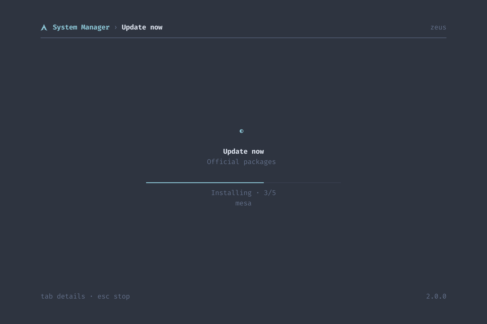
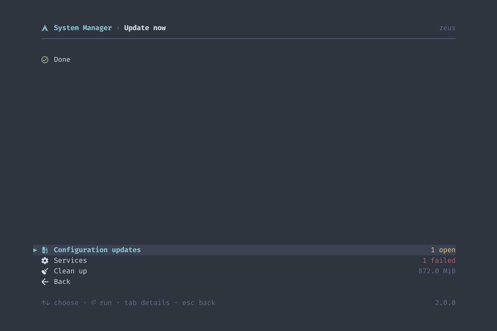

# Reference

## How It Works

```
system-manager              one binary: runtime, scripts, themes, translations, fonts
src/                        the runtime: interface, parsers, logging, no system command of its own
scripts/<name>/script.sh    one area of the system: its operations as functions
scripts/<name>/script.yaml  what the runtime needs to know about them
scripts/<name>/…            files the script puts in place, such as desktop/logo.svg
scripts/lib.sh, lib.yaml    sourced first by every script, and the causes every run may hit
themes/<id>.yaml            built-in themes
locales/de.po               German, the English source is in the code
assets/fonts/               Fira Code and the Nerd Font symbols, for the window
aur/                        the AUR package arch-os-manager, built from source, stamped at a release
docs/screenshots.sh         the pictures, out of example data through the window's painter
docs/banner.sh              the README's banner out of docs/wordmark.txt, with the banner.py Arch OS has
```

The scripts are written to `$XDG_RUNTIME_DIR/system-manager-<pid>/` once per process, readable by the user only, and removed on exit.

## Scripts

An operation is called as `script.sh <operation> <arguments>`. `operation` in `lib.sh` runs the function `op_<operation>`, a dash in the name an underscore in the function. It reads in one of two ways:

| Way | Terminal | Questions | Limit | Used for |
|---|---|---|---|---|
| Query | none | none | 120 s | reading state, printing lines the runtime parses |
| Run | its own pseudo terminal | answered in the interface | none | changing the system |

A query may not call `sudo`, and the runtime refuses to start one whose yaml says `root: true`.

### The yaml

| Key | Meaning |
|---|---|
| `ops` | Each operation by name, with the keys below |
| `errors` | Exit code from 10 on: headline, then explanation. A test holds them against the `exit` lines |
| `hints` | Output line containing the key: `text` as headline, then explanation, `offer` the page that fixes it. `lib.yaml` holds pacman's |
| `probe` | `features` only: each optional package under its group, the `command` that proves it works, and what it `adds`. One with `extension: true` comes from extensions.gnome.org |

| Operation key | Meaning |
|---|---|
| `title` | What it does, as a gerund: the title of its run, the start of its failure |
| `confirm` | Asked before the run: the question, then what happens |
| `root` | It calls `sudo`, so the password is asked before the run. A test holds this against the function |
| `needs` | Optional packages it cannot run without, shown as unavailable until they are there |
| `steps` | `step <key>` on fd 3 shows this sentence during the run |

Every sentence is English and translated in `locales/de.po`.

### Exit Codes and Events

| Exit | Meaning |
|---|---|
| `0` | Done |
| `1` | Unexpected: lib.sh's trap wrote file, line and command to fd 3 |
| `2` | No such operation |
| `10` to `99` | Declared in `errors` |

| fd 3 line | Meaning |
|---|---|
| `step\t<key>` | The run entered a step of `steps` |
| `fail\t<code>\t<file>\t<line>\t<command>` | The trap, whose source line the runtime shows |

### Environment

| Variable | Value |
|---|---|
| `LC_ALL` | `C.UTF-8`: output and questions in one known wording |
| `SM_AUR` | The AUR helper of the settings, empty for none |
| `SUDO_PROMPT` | A fixed prompt the runtime recognises |
| `TERM` | `xterm-256color` in a run |

`lib.sh` sets `set -Eeuo pipefail`, `inherit_errexit` and `nullglob`, and offers:

| Function | Does |
|---|---|
| `operation` | Runs `op_<name>`, as the last line of every script |
| `step` | Names the phase of a run |
| `fetch` | curl bound to https, redirects too, with time limits |
| `aur` | The helper of `$SM_AUR` |
| `aur_sync` | The helper without the review and menus a run cannot answer |

A function more than one script needs goes into `lib.sh`. The rest stays in its script.

### A New Operation

1. `op_<name>` in `scripts/<area>/script.sh`. A new area is a folder whose `script.sh` starts with the two lines that source `lib.sh` and ends with `operation "$@"`
2. Its entry under `ops` in `script.yaml`, with at least `title`
3. Its constant in `script::op` in `src/script/mod.rs`
4. Its sentences in `locales/de.po`

`make check` fails until all four agree.

## The Start Page

Under the header, one row shows in percent what the machine uses, read every two seconds off the drawing thread. `usage: false` switches it off:

| Block | In use | Read from |
|---|---|---|
| CPU | Busy ticks of all, over the last two seconds | `/proc/stat` |
| RAM | What `MemAvailable` leaves, as `free` counts it | `/proc/meminfo` |
| Disk | Of `/`, as `df` counts it | `statvfs` |

A block shows an icon and the name in `muted`, then a bar and the share in `success` below 75 %, `warning` below 90 % and `error` from there. The bar has 8 cells to the 13 of the rest, the golden ratio, and one less where the two gaps would otherwise differ by a cell. CPU starts in the menu's icon column, disk ends at its right edge, RAM stands in the middle. Short of room the bars go first, then the names where icons say them. The Linux console has no icons and keeps the names. `?` stands where a value could not be read. Where the whole menu would not fit under the row, and during a search, it does not show.

## Runs

A run is named in the header after the action chosen, and shows its step and pacman's progress. **tab** switches to the terminal itself, where every key goes to the program. A question appears in both: in the overview as a choice, in the terminal as typed.



| Question | Overview |
|---|---|
| `[Y/n]`, `[y/N]` | Yes or no, the default first |
| `Enter a number (default=N):` | The numbered choices, such as providers |
| `Enter a selection` and helper menus ending in `==>` | A text box, where enter keeps the default |
| The sudo prompt | The password |

**Repair** removes a database lock no process holds, builds the keyring anew beside the old one and updates. **Check the files** runs `pacman -Qkk` as root and installs every native package with an altered or missing file again, as a configuration changed by hand is a backup file pacman lists apart. A package of the AUR is only named. Taking over or merging a configuration update first takes a snapshot where snapper keeps the root, which its number limit prunes.

pacman's `Proceed with installation?`, `Proceed with download?` and `Do you want to remove these packages?` are answered yes: the person confirmed before the run. Conflicts, replacements and keys are always asked.

**esc**, **q** and **ctrl+c** ask whether to stop, and yes sends ctrl+c to the program. A failure shows the declared error or a recognised cause, the source line, the last output and the log, and offers the page the cause names, another try and the way back.

After a run, the manager reads the system again and offers what may follow, none of it a must:

| Offer | When |
|---|---|
| Restart | A new kernel waits |
| Configuration updates | `.pacnew` or `.pacsave` files are open |
| Services | A service failed |
| Clean up | Unneeded packages, or 1 GiB to free, and not after a clean-up |



**Note:** _A question in another shape still waits in the terminal view, which tab reaches._

### The Password

Asked once per session, before the first run that elevates, and proven with `sudo --validate`. sudo starts only once a password is typed, and never gets an empty one: pam_faillock counts a prompt left unanswered and an empty password as failed attempts, and locks the account after three. `sudo --non-interactive --validate`, which no PAM module counts, tells beforehand whether it is needed at all. It is held in memory only and answers every later sudo prompt of every run, also those of an AUR helper. It is written only while the terminal does not echo, so it never reaches the output or the log. A wrong one is forgotten and asked again. With `NOPASSWD` it is never asked.

## Files

| Path | Content |
|---|---|
| `~/.arch-os/settings.yaml` | What was chosen, an absent key being the default |
| `~/.arch-os/themes/<id>.yaml` | Own themes |
| `~/.arch-os/state.yaml` | News read, updates already announced |
| `~/.arch-os/logs/system-manager.log` | The runtime and every run, rotated at 2 MiB |
| `~/.arch-os/cache/news.xml` | The feed as last loaded, for offline |
| `~/.local/share/applications/system-manager.desktop` | The app menu entry, opening the window |
| `~/.local/share/icons/hicolor/scalable/apps/system-manager.svg` | Its icon, the Arch OS logo |
| `~/.config/systemd/user/system-manager-notify.{service,timer}` | The update notification, as often as `notify` says |
| `~/.local/share/gnome-shell/extensions/arch-update@RaphaelRochet/` | The update indicator, when installed |

`SM_HOME` puts all of it elsewhere, for a throwaway run.

## Settings

| Key | Values | Default |
|---|---|---|
| `language` | `en`, `de` | from `LC_ALL`, `LC_MESSAGES`, `LANG` |
| `theme` | a theme id | `nord` |
| `usage` | `true`, `false` | `true` |
| `aur-helper` | `paru`, `yay`, `none` | paru, else yay |
| `app-menu` | `true`, `false` | `true` |
| `notify` | `hourly`, `daily`, `weekly`, `off` | `hourly` |
| `hidden-log` | messages hidden from the system log | none |

A file that does not parse is left alone and named under **Settings › About**, and the defaults apply until a setting is changed. The first start or `init` takes the settings of the `arch-os` script before 2.0 over once, where none are chosen, and removes what it left. `scripts/migrate/script.sh` says how to remove this.

Every start and `system-manager init` put the app menu entry and the update notification in place as `app-menu` and `notify` say, for the binary where it lies now. An installer calls `init` to have both before the first start, from its chroot as the user. Both need a desktop, the notification also libnotify. Until they are there, the settings wait. The timer announces two minutes after login and then as often as chosen. Where the update indicator is installed, they also point its commands at the binary. Where no session bus answers, as in a chroot, through a private one of `dbus-run-session`, which dconf writes to the user's database all the same.

A hidden message is stored with its numbers, hex values and hashes as `#`, so it stays hidden when only those change. It hides only messages equal to it apart from these.

## Themes

```yaml
name: Nord
colors:
  background: "#2E3440"
  surface: "#3B4252"
  muted: "#616E88"
  text: "#D8DEE9"
  accent: "#88C0D0"
  success: "#A3BE8C"
  warning: "#EBCB8B"
  error: "#BF616A"
```

| Slot | Used for |
|---|---|
| `background` | Everything behind |
| `surface` | The track of a bar and of a scrollbar, the row under the cursor |
| `muted` | Hints, secondary values, disabled rows |
| `text` | Labels and text |
| `accent` | Cursor, title, progress, pending updates |
| `success`, `warning`, `error` | States |

The built-in themes are the files in [`themes/`](../themes), listed by name. Each reads on its background at WCAG AA: 4.5 for `text`, 3 for `accent` and the states, and a test holds them to it.

A file in `~/.arch-os/themes/` with the id of a built-in replaces it. One that does not parse is skipped and named under **Settings › About**. The Linux console, told by `TERM=linux`, gets its own sixteen colours, the row under the cursor on plain blue, as only the eight plain colours work behind text there, and ASCII in place of every glyph: no icons and no column for them, `#` for the logo, `>` for the cursor, `*` for a dot, `+` for a mark, the keys named in words in the footer.

## Icons

The icons are Material Design symbols of the Nerd Fonts. The window carries them, a terminal shows them with a Nerd Font such as `ttf-nerd-fonts-symbols`, and the Linux console shows none.

## Keys

| Key | Outside a text box | In a text box |
|---|---|---|
| **↑↓**, **j k** | Choose | ↑↓ choose |
| **⇞⇟** | A page further | the same |
| Wheel | As ↑↓ | the same |
| **⏎**, **l**, **→** | Open | ⏎ open |
| **esc** | Back | Close the box |
| **backspace**, **h**, **←** | Back | Delete |
| **f**, **/** | Filter, on the start page a search over everything | typed |
| **g**, **G** | First, last | typed |
| **q** | Quit | typed |
| **ctrl+c** | Quit, in a run ask to stop | the same |
| **tab** | In a run overview or terminal, on the packages page mark | the same |

On the start page, **f** searches every page and setting, and **r** reads every value anew once the last reading is done.

Actions stay under what they are about, so ↑↓ always reaches them. What does not fit above them scrolls with **⇞⇟** and the wheel, while a page's head, such as an entry's time and source, stays. A bar in the right margin shows where a list or a text stands. In a terminal the wheel needs the mouse, so text is selected with shift held.

Held down, a key repeats only to move or to type, everything else happens once per press. A terminal sends a held key as presses, so the same key again within 150 ms counts as held.

The start screen stands three seconds while the first values load, and again on **r**, and any other key skips it. It is drawn before anything is read: the reading, the take-over of the old manager and the icon font begin with its first frame, which processes started earlier would hold back.

## Command Line

| Command | Does |
|---|---|
| `system-manager` | The interface in the terminal, or in a window without one |
| `system-manager --window` | In a window |
| `system-manager <page>` | Opens on `upgrade`, `news`, `packages`, `services`, `log`, `cleanup`, `pacnew`, `mirrors`, `firmware`, `repair`, `settings`, `features` |
| `system-manager init` | Puts the app menu entry, the update notification and the update indicator in place |
| `system-manager check` | Pending updates as checkupdates prints them: an AUR package as `aur/name`, a Flatpak with its commits where the versions do not tell the change, an unknown version as `?`, and exit 2 without any |
| `system-manager notify` | Announces pending updates, with `--new` only those not announced before, as the timer runs it |

It runs as the user and asks for the sudo password itself. As root it only answers `check`.

## Optional Packages

| Group | Package | Adds |
|---|---|---|
| `packages` | `paru` or `yay` | Builds and updates packages from the AUR |
| `packages` | `pacman-contrib` | Lists updates, trims the cache and finds configuration updates |
| `packages` | `reflector` | Ranks the mirrors by speed |
| `packages` | `flatpak` | Updates and cleans up Flatpak apps |
| `packages` | `fwupd` | Updates the firmware of the device |
| `desktop` | `gnome-arch-update` | A GNOME Shell extension that shows pending updates in the top bar |
| `desktop` | `libnotify` | Desktop notifications about new updates |
| `desktop` | `meld` | Merges configuration updates side by side |

A package counts when its command answers, as `probe` in `scripts/features/script.yaml` names it under its group. The page lists them under their group, sorted by group, then by package. One that `needs` a fact is offered only where it holds:

| Fact | Holds when | Needed by |
|---|---|---|
| `desktop` | A session lies in `/usr/share/wayland-sessions` or `/usr/share/xsessions` | flatpak, meld, libnotify, the app menu entry, the notification |
| `gnome` | `gnome-shell` is installed | gnome-arch-update |

**Settings › Optional packages** installs and removes each:

| Package | Beyond pacman |
|---|---|
| `paru`, `yay` | Built from source from the AUR with makepkg, as Arch OS does, after `git` and `base-devel`, and the build dependencies go again |
| `reflector` | `/etc/xdg/reflector/reflector.conf`: https, synced within 12 hours, the 10 latest, by speed, the country of the time zone. `reflector.timer` enabled, and disabled on removal |
| `gnome-arch-update` | The Arch Linux Updates Indicator from extensions.gnome.org in the version for this GNOME Shell, installed and enabled for the user. GNOME loads it at the next login. Its `check-cmd`, `update-cmd` and `package-manager` run this binary |

Removal is `pacman -Rns`, of an AUR helper whichever package owns its command, such as `paru-bin`. The indicator is disabled and uninstalled with its settings. One from a package goes with that package.

## Clean-Up and the Recovery

The page lists every part with its count and size, also where there is nothing, with what is good to know right under it. Sizes below a KiB are spelled out in bytes.

The cache keeps three versions of every installed package and none of what is gone, as `paccache -r` and `paccache -ruk0` choose. On top, every kernel package a snapshot in `/.snapshots` has installed stays, whatever its age: the Recovery of Arch OS rebuilds a rolled back snapshot's boot files from it. A cache it cannot judge, because `/.snapshots` is unreadable, is not trimmed. Unneeded packages go with `pacman -Rns`, AUR build folders of packages no longer installed are removed, and Flatpak drops unused runtimes.

## Mirrors

**Rank the mirrors now** starts `reflector.service`, which reads `/etc/xdg/reflector/reflector.conf`: the same ranking `reflector.timer` does weekly, as Arch OS or the installation above configured it.

## Building

| Target | Does |
|---|---|
| `make check` | Format, clippy, shellcheck, yamllint, actionlint, zizmor, msgfmt, tests, release build, before every commit |
| `make run` | The interface against a throwaway `target/home` |
| `docs/screenshots.sh [x.y.z]` | `docs/screenshots/` from example data through the window's painter, showing that version |
| `docs/banner.sh` | `docs/banner.png` from two screenshots, with chromium, imagemagick and Fira Code |
| `make install` | `~/.local/bin/system-manager` |
| `make aur-check` | `aur/PKGBUILD` stamped with stand-ins and read by makepkg |

`VERSION` names the version a build is for. Without it, build.rs names a pre-release of the patch after the last release in `.release-please-manifest.json`, such as `1.9.2-dev`.

A pull request's title is a Conventional Commit: `feat:`, `fix:`, `feat!:` for a breaking change. Its squash commit on `main` is what release-please reads: it keeps a release pull request open with the next version and its section of `CHANGELOG.md`. Merging that pull request tags `vX.Y.Z` with a draft release. `make check VERSION=X.Y.Z` builds that version, and the binary, its checksum, `PKGBUILD`, `SRCINFO` and `arch-os-manager.install` for the tag's source tarball go on the release, which is published last. The job `AUR` then builds the last three with makepkg, as a user would, and `tools/aur-push.sh` puts them in the AUR repository of `arch-os-manager`, `SRCINFO` as `.SRCINFO`. The AUR package builds the tarball with cargo for its version. Its key is the secret `AUR_SSH_KEY` of the environment `aur`, which only `main` may use. `tools/aur-key.sh` makes it and prints the public half for the AUR account.

Tests run on Arch, as the CI does: the scripts against stand-ins for pacman, sudo and friends, the read-only ones against the real pacman. The kernel test of the clean-up needs root, as the CI container has.
