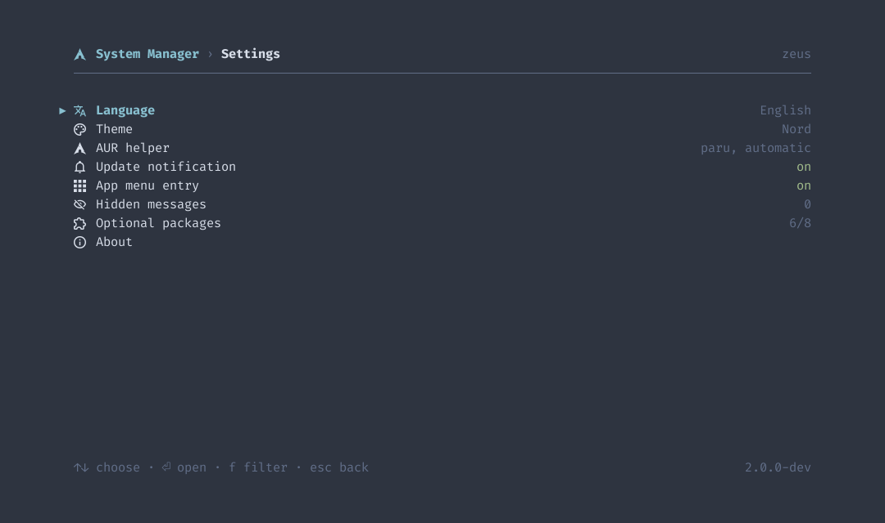
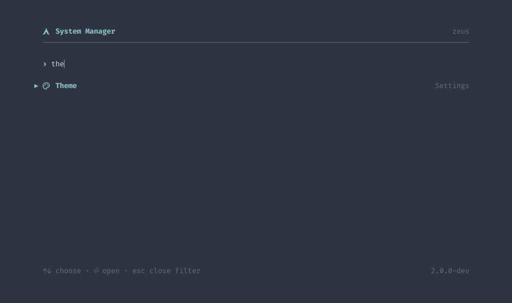
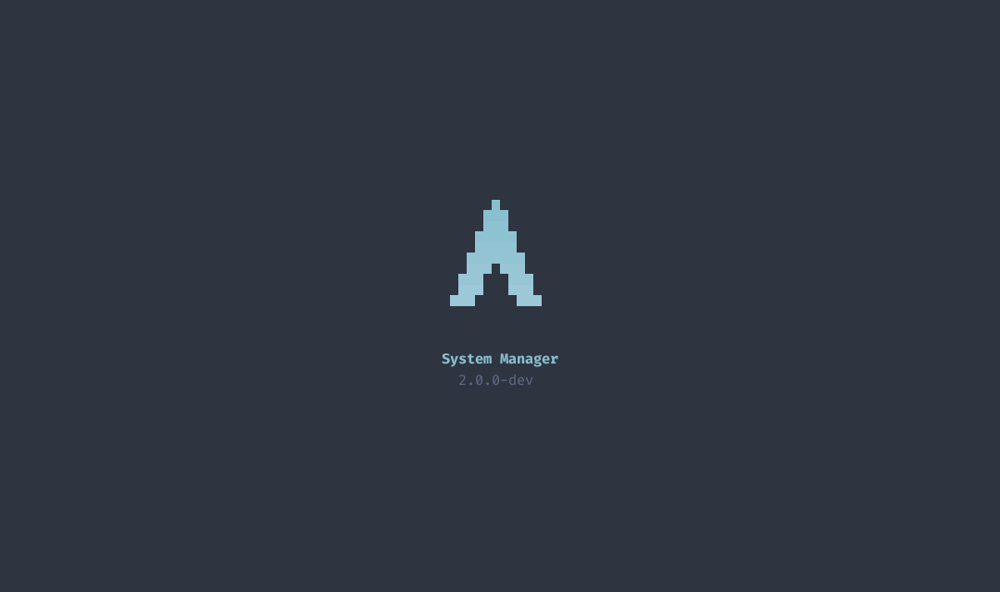

# Reference

## How It Works

```
system-manager              one binary: runtime, scripts, themes, translations, fonts
src/                        the runtime: interface, parsers, logging; it runs no system command itself
scripts/<name>/script.sh    one area of the system: its operations as functions
scripts/<name>/script.yaml  what the runtime needs to know about them
scripts/<name>/…            files the script puts in place, such as desktop/logo.svg
scripts/lib.sh, lib.yaml    sourced first by every script; causes every run may hit
themes/<id>.yaml            built-in themes
locales/de.po               German; English is the source
assets/fonts/               Fira Code and the Nerd Font symbols, for the window
aur/                        the AUR package arch-os-manager, built from source, stamped at a release
```

The scripts are written to `$XDG_RUNTIME_DIR/system-manager-<pid>/` once per process, readable by the user only, and removed on exit.

## Scripts

An operation is called as `script.sh <operation> <arguments>`; `operation` in `lib.sh` runs the function `op_<operation>`, a dash in the name an underscore in the function. It reads in one of two ways:

| Way | Terminal | Questions | Limit | Used for |
|---|---|---|---|---|
| Query | none | none | 120 s | reading state, printing lines the runtime parses |
| Run | its own pseudo terminal | answered in the interface | none | changing the system |

A query may not call `sudo`; the runtime refuses to start one whose yaml says `root: true`.

### The yaml

| Key | Meaning |
|---|---|
| `ops` | Each operation by name, with the keys below |
| `errors` | Exit code from 10 on: headline, then explanation. A test holds them against the `exit` lines |
| `hints` | Output line containing the key: `text` as headline, then explanation; `offer` the page that fixes it. `lib.yaml` holds pacman's |
| `probe` | `features` only: each optional package, the `command` that proves it works, and what it `adds` |

| Operation key | Meaning |
|---|---|
| `title` | What it does, as a gerund: the title of its run, the start of its failure |
| `confirm` | Asked before the run: the question, then what happens |
| `root` | It calls `sudo`; the password is asked before the run. A test holds this against the function |
| `needs` | Optional packages it cannot run without; without them the interface shows it unavailable |
| `steps` | `step <key>` on fd 3 shows this sentence during the run |

Every sentence is English and translated in `locales/de.po`.

### Exit Codes and Events

| Exit | Meaning |
|---|---|
| `0` | Done |
| `1` | Unexpected: lib.sh's trap wrote file, line and command to fd 3 |
| `2` | No such operation |
| `10` to `99` | Declared in `errors` |

| fd 3 line | Meaning |
|---|---|
| `step\t<key>` | The run entered a step of `steps` |
| `fail\t<code>\t<file>\t<line>\t<command>` | The trap; the runtime shows the source line |

### Environment

| Variable | Value |
|---|---|
| `LC_ALL` | `C.UTF-8`: output and questions in one known wording |
| `SM_AUR` | The AUR helper of the settings, empty for none |
| `SUDO_PROMPT` | A fixed prompt the runtime recognises |
| `TERM` | `xterm-256color` in a run |

`lib.sh` sets `set -Eeuo pipefail`, `inherit_errexit` and `nullglob`, and offers:

| Function | Does |
|---|---|
| `operation` | Runs `op_<name>`; the last line of every script |
| `step` | Names the phase of a run |
| `fetch` | curl bound to https, redirects too, with time limits |
| `aur` | The helper of `$SM_AUR` |
| `aur_sync` | The helper without the review and menus a run cannot answer |

A function more than one script needs goes into `lib.sh`; the rest stays in its script.

### A New Operation

1. `op_<name>` in `scripts/<area>/script.sh`; a new area is a folder whose `script.sh` starts with the two lines that source `lib.sh` and ends with `operation "$@"`
2. Its entry under `ops` in `script.yaml`, with at least `title`
3. Its constant in `script::op` in `src/script/mod.rs`
4. Its sentences in `locales/de.po`

`make check` fails until all four agree.

## Runs

A run shows its title, its step and pacman's progress; **tab** switches to the terminal itself, where every key goes to the program. A question appears in both: in the overview as a choice, in the terminal as typed.

| Question | Overview |
|---|---|
| `[Y/n]`, `[y/N]` | Yes or no, the default first |
| `Enter a number (default=N):` | The numbered choices, such as providers |
| `Enter a selection` and helper menus ending in `==>` | A text box; enter keeps the default |
| The sudo prompt | The password |

pacman's `Proceed with installation?`, `Proceed with download?` and `Do you want to remove these packages?` are answered yes: the person confirmed before the run. Conflicts, replacements and keys are always asked.

**esc**, **q** and **ctrl+c** ask whether to stop; yes sends ctrl+c to the program. A failure shows the declared error or a recognised cause, the source line, the last output and the log, and offers the page the cause names, another try and the way back.

After a run, the manager reads the system again and offers what may follow, none of it a must:

| Offer | When |
|---|---|
| Restart | A new kernel waits |
| Configuration updates | `.pacnew` or `.pacsave` files are open |
| Services | A service failed |
| Clean up | Unneeded packages, or 1 GiB to free; not after a clean-up |


**Note:** _A question in another shape still waits in the terminal view; tab reaches it._

### The Password

Asked once per session, before the first run that elevates, and proven with `sudo --validate`. It is held in memory only and answers every later sudo prompt of every run, also those of an AUR helper; it is written only while the terminal does not echo, so it never reaches the output or the log. A wrong one is forgotten and asked again. With `NOPASSWD` it is never asked.

## Files

| Path | Content |
|---|---|
| `~/.arch-os/settings.yaml` | What was chosen; an absent key is the default |
| `~/.arch-os/themes/<id>.yaml` | Own themes |
| `~/.arch-os/state.yaml` | News read, updates already announced |
| `~/.arch-os/logs/system-manager.log` | The runtime and every run; rotated at 2 MiB |
| `~/.arch-os/cache/news.xml` | The feed as last loaded, for offline |
| `~/.local/share/applications/system-manager.desktop` | The app menu entry, opening the window |
| `~/.local/share/icons/hicolor/scalable/apps/system-manager.svg` | Its icon, the Arch OS logo |
| `~/.config/systemd/user/system-manager-notify.{service,timer}` | The update notification, hourly |
| `~/.local/share/gnome-shell/extensions/arch-update@RaphaelRochet/` | The update indicator, when installed |

`SM_HOME` puts all of it elsewhere, for a throwaway run.

## Settings

| Key | Values | Default |
|---|---|---|
| `language` | `en`, `de` | from `LC_ALL`, `LC_MESSAGES`, `LANG` |
| `theme` | a theme id | `nord` |
| `aur-helper` | `paru`, `yay`, `none` | paru, else yay |
| `app-menu` | `true`, `false` | `true` |
| `notify` | `true`, `false` | `true` |
| `hidden-log` | messages hidden from the system log | none |



A file that does not parse is left alone and named under **Settings › About**; the defaults apply until a setting is changed.

Every start and `system-manager init` put the app menu entry and the update notification in place as `app-menu` and `notify` say, for the binary where it lies now; an installer calls `init` to have both before the first start. Both need a desktop, the notification also libnotify; until they are there, the settings wait. Where the update indicator is installed, they also point its commands at the binary.

A hidden message is stored with its numbers, hex values and hashes as `#`, so it stays hidden when only those change. It hides only messages equal to it apart from these.

## Themes

```yaml
name: Nord
colors:
  background: "#2E3440"
  surface: "#3B4252"
  muted: "#616E88"
  text: "#D8DEE9"
  accent: "#88C0D0"
  success: "#A3BE8C"
  warning: "#EBCB8B"
  error: "#BF616A"
```

| Slot | Used for |
|---|---|
| `background` | Everything behind |
| `surface` | The track of a progress bar |
| `muted` | Hints, secondary values, disabled rows |
| `text` | Labels and text |
| `accent` | Cursor, title, progress, pending updates |
| `success`, `warning`, `error` | States |

A file in `~/.arch-os/themes/` with the id of a built-in replaces it; one that does not parse is skipped and named under **Settings › About**. The Linux console gets its own sixteen colours and ASCII glyphs.

## Icons

The icons are Material Design symbols of the Nerd Fonts. The window carries them; a terminal shows them with a Nerd Font, such as `ttf-nerd-fonts-symbols`; the Linux console shows none.

## Keys

| Key | Outside a text box | In a text box |
|---|---|---|
| **↑↓**, **j k** | Choose | ↑↓ choose |
| **⏎**, **l**, **→** | Open | ⏎ open |
| **esc** | Back | Close the box |
| **backspace**, **h**, **←** | Back | Delete |
| **f**, **/** | Filter; on the start page, search everything | typed |
| **g**, **G** | First, last | typed |
| **q** | Quit | typed |
| **ctrl+c** | Quit; in a run, ask to stop | the same |
| **tab** | Runs: overview or terminal; packages: mark | the same |

On the start page, **f** searches every page and setting:



The start screen stands three seconds while the first values load; any key skips it:



## Command Line

| Command | Does |
|---|---|
| `system-manager` | The interface in the terminal; without one, in a window |
| `system-manager --window` | In a window |
| `system-manager <page>` | Opens on `upgrade`, `news`, `packages`, `services`, `log`, `cleanup`, `pacnew`, `mirrors`, `firmware`, `repair`, `settings`, `features` |
| `system-manager init` | Puts the app menu entry, the update notification and the update indicator in place |
| `system-manager check` | Pending updates as checkupdates prints them; exit 2 without any |
| `system-manager notify` | Announces pending updates; with `--new` only those not announced before, as the timer runs it |

## Optional Packages

| Package | Adds |
|---|---|
| `pacman-contrib` | The list of updates, the clean-up, the configuration updates |
| `paru` or `yay` | AUR packages |
| `flatpak` | Flatpak apps in the update and the clean-up |
| `reflector` | Ranking the mirrors |
| `meld` | Merging configuration updates side by side |
| `libnotify` | Notifications about new updates |
| `fwupd` | Firmware updates |
| `arch-update` | Pending updates in the GNOME top bar |

A package counts when its command answers, as `probe` in `scripts/features/script.yaml` names it. One that `needs` a fact is offered only where it holds:

| Fact | Holds when | Needed by |
|---|---|---|
| `desktop` | A session lies in `/usr/share/wayland-sessions` or `/usr/share/xsessions` | flatpak, meld, libnotify, the app menu entry, the notification |
| `gnome` | `gnome-shell` is installed | arch-update |

**Settings › Optional packages** installs and removes each:

| Package | Beyond pacman |
|---|---|
| `paru`, `yay` | Built from source from the AUR with makepkg, as Arch OS does, after `git` and `base-devel`; the build dependencies go again |
| `reflector` | `/etc/xdg/reflector/reflector.conf`: https, synced within 12 hours, the 10 latest, by speed, the country of the time zone; `reflector.timer` enabled, and disabled on removal |
| `arch-update` | The Arch Linux Updates Indicator from extensions.gnome.org in the version for this GNOME Shell, installed and enabled for the user; GNOME loads it at the next login. Its `check-cmd`, `update-cmd` and `package-manager` run this binary |

Removal is `pacman -Rns`; of an AUR helper, whichever package owns its command, such as `paru-bin`. The indicator is disabled and uninstalled with its settings; one from a package goes with that package.

## Clean-Up and the Recovery

The cache keeps three versions of every installed package and none of what is gone, as `paccache -r` and `paccache -ruk0` choose. On top, every kernel package a snapshot in `/.snapshots` has installed stays, whatever its age: the Recovery of Arch OS rebuilds a rolled back snapshot's boot files from it. A cache it cannot judge, because `/.snapshots` is unreadable, is not trimmed. Unneeded packages go with `pacman -Rns`, AUR build folders of packages no longer installed are removed, and Flatpak drops unused runtimes.

## Mirrors

**Rank the mirrors now** starts `reflector.service`, which reads `/etc/xdg/reflector/reflector.conf`: the same ranking `reflector.timer` does weekly, as Arch OS or the installation above configured it.

## Building

| Target | Does |
|---|---|
| `make check` | Format, clippy, shellcheck, yamllint, msgfmt, tests, release build; before every commit |
| `make run` | The interface against a throwaway `target/home` |
| `make screenshots` | `docs/screenshots/` from example data |
| `make install` | `~/.local/bin/system-manager` |
| `make aur-check` | `aur/PKGBUILD` stamped with stand-ins and read by makepkg |
| `make release VERSION=x.y.z` | `dist/`: the built binary stamped with the version, its checksum, its notes, and `aur/` with the PKGBUILD stamped for `dist/source.tar.gz`, its `.SRCINFO` and install file |

Cargo.toml carries the next version with `-dev`. A tag `vX.Y.Z` runs `make check`, stamps that same binary with `X.Y.Z`, reads the version back, and publishes it with the section of `CHANGELOG.md` for it; a version without one stops the release. The release carries the binary, its checksum, `PKGBUILD`, `SRCINFO` and `arch-os-manager.install`; the last three go to the AUR repository of `arch-os-manager`, `SRCINFO` as `.SRCINFO`. The AUR package builds the tag's source tarball with cargo and stamps the version as the release does.

Tests run on Arch, as the CI does: the scripts against stand-ins for pacman, sudo and friends, the read-only ones against the real pacman. The kernel test of the clean-up needs root, as the CI container has.

## From the Arch OS Manager

| Then | Now |
|---|---|
| `arch-os` with gum and kitty downloaded | One binary, terminal or window |
| 22 settings in a text editor | Six settings, the rest decided |
| `--install` patching `/etc/paru.conf` | No system file patched; optional packages installed and removed in place |
| Cache emptied with `-Scc` | Trimmed, the Recovery's kernels kept |
| Own reflector call and country setting | `reflector.service` with Arch OS's configuration |
| meld as root through `sudo pacdiff` | meld as the user, the file copied in as root |
| `downgrade` from the AUR | Cache and Archive, without it |
| Autostart entry with `sleep 60` | User timer, updates announced once |
| News in the browser | News in place |

The AUR package `arch-os-manager` turns into this one with an update. The first start or `init` takes the old manager over once:

| Left by the old manager | Becomes |
|---|---|
| `AUTOSTART_NOTIFY=false` | `notify: false` |
| `AUR_SUPPORT=false`, `AUR_MANGER_REPO=yay…` | `aur-helper: none`, `yay` |
| `~/.arch-os/bin`, `config/`, `database/`, its autostart entry | Removed |
| `arch-os.desktop` in the GNOME dock | `system-manager.desktop` |

A setting chosen in `settings.yaml` already wins. The blacklist does not carry over: the log hides whole messages now. `scripts/migrate/script.sh` says how to remove the migration once no 1.x is left.
